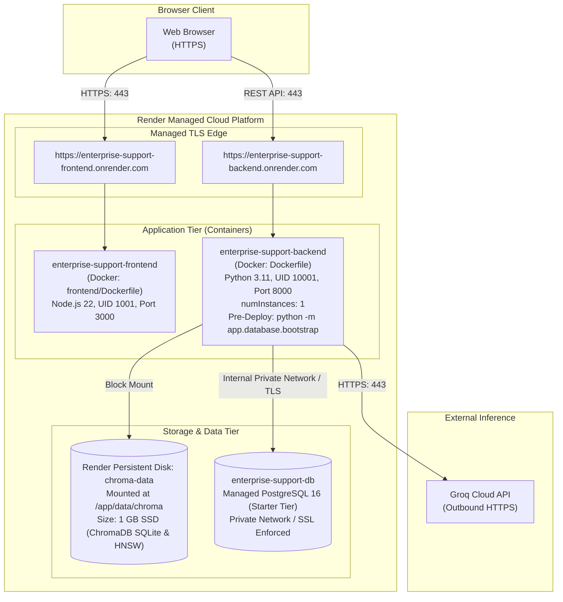

# Phase 11 — Task 2: Cloud Manifest & Infrastructure-as-Code Readiness Report

**Status Classification:** **GREEN**  
*(The repository is fully prepared for Render deployment with validated Infrastructure-as-Code blueprints, deterministic database bootstrap logic, strict secret hygiene, and zero regressions to local Docker workflows.)*

---

## 1. Implementation Summary

In Phase 11 Task 2, we created the Infrastructure-as-Code (IaC) configuration and database bootstrap mechanisms required for deploying the **Enterprise Support AI Agent** to Render, without provisioning live cloud resources or consuming credentials.

Key accomplishments:
1. **Render Blueprint Manifest (`render.yaml`)**:
   - Declares managed PostgreSQL 16 database (`enterprise-support-db`).
   - Declares single-instance FastAPI REST backend (`enterprise-support-backend`) with a 1 GB Persistent Disk mounted at `/app/data/chroma`.
   - Declares multi-stage Next.js frontend (`enterprise-support-frontend`) pointing to the backend's public HTTPS URL.
   - Strictly enforces secret hygiene (`sync: false` for API keys, automatic `fromDatabase` connection strings, zero hardcoded credentials).
2. **Database Bootstrap & Separation of Responsibilities**:
   - Built [`app/database/bootstrap.py`](app/database/bootstrap.py) to provide idempotent schema creation, LangGraph checkpoint table initialization, and optional demo seeding.
   - Enhanced [`app/database/config.py`](app/database/config.py) to parse `DATABASE_URL` (host, port, dbname, user, password, `sslmode`) while maintaining fallback to individual environment variables for local native and Docker Compose workflows.
   - Enhanced [`app/database/connection.py`](app/database/connection.py) so `ensure_database_exists()` avoids attempting superuser maintenance database connections when the target database is already accessible.
   - Separated schema creation from demo seeding in [`app/database/seed.py`](app/database/seed.py), adding `is_database_seeded()` and `only_if_empty=True` guards to prevent accidental overwriting of existing production data.
3. **Environment Documentation**:
   - Refactored [`.env.example`](.env.example) into three explicit security tiers: Backend Runtime Secrets, Backend Operational Configuration, and Frontend Public Configuration.
4. **Cloud Documentation**:
   - Updated [`docs/CLOUD_DEPLOYMENT.md`](docs/CLOUD_DEPLOYMENT.md) with a concrete "Render Deployment Preparation" section detailing blueprint components, service communication, persistent storage, and bootstrap workflows.
5. **Deterministic Testing**:
   - Added [`tests/test_cloud_bootstrap.py`](tests/test_cloud_bootstrap.py) covering 11 automated test cases verifying blueprint syntax, secret hygiene, single-instance constraints, `DATABASE_URL` parsing, schema idempotency, demo seed isolation, and Docker Compose preservation.

---

## 2. Files Created and Modified

| File | Type | Purpose |
|---|---|---|
| [`render.yaml`](render.yaml) | **NEW** | Render Infrastructure-as-Code blueprint declaring managed PostgreSQL, backend Docker service with persistent disk, and frontend Docker service |
| [`app/database/bootstrap.py`](app/database/bootstrap.py) | **NEW** | Deterministic, idempotent database bootstrap module and CLI entrypoint (`python -m app.database.bootstrap`) |
| [`tests/test_cloud_bootstrap.py`](tests/test_cloud_bootstrap.py) | **NEW** | Focused deterministic test suite (11 test cases) validating blueprint, bootstrap logic, and environment security |
| [`app/database/config.py`](app/database/config.py) | **MODIFIED** | Added `DATABASE_URL` parsing support with query string parsing (`sslmode`) in `DatabaseConfig` |
| [`app/database/connection.py`](app/database/connection.py) | **MODIFIED** | Updated `ensure_database_exists()` to bypass maintenance DB connections when target DB is already accessible |
| [`app/database/schema.py`](app/database/schema.py) | **MODIFIED** | Robust `SCHEMA_SQL_PATH` resolution relative to repository root |
| [`app/database/seed.py`](app/database/seed.py) | **MODIFIED** | Added `is_database_seeded()` check and `only_if_empty` guard preventing production data overwrites |
| [`app/database/__init__.py`](app/database/__init__.py) | **MODIFIED** | Exported `bootstrap_database` and `is_database_seeded` |
| [`.env.example`](.env.example) | **MODIFIED** | Organized into strict security categories with explicit secret handling instructions |
| [`docs/CLOUD_DEPLOYMENT.md`](docs/CLOUD_DEPLOYMENT.md) | **MODIFIED** | Added Section 12 ("Render Deployment Preparation") and updated roadmap |
| [`CLOUD_MANIFEST_READINESS_REPORT.md`](CLOUD_MANIFEST_READINESS_REPORT.md) | **NEW** | Phase 11 Task 2 formal readiness and verification report |

---

## 3. Render Architecture Represented by Manifest

---

## 4. Environment Variable Mapping

| Variable Name | Render Manifest Definition | Scope & Security Classification |
|---|---|---|
| `DATABASE_URL` | `fromDatabase: { name: enterprise-support-db, property: connectionString }` | Backend Runtime Secret (Private network URL with password) |
| `CHECKPOINT_DB_URL` | `fromDatabase: { name: enterprise-support-db, property: connectionString }` | Backend Runtime Secret (Points to managed DB for LangGraph checkpoints) |
| `LLM_API_KEY` | `sync: false` | Backend Runtime Secret (Configured in Render Dashboard; never in Git) |
| `GROQ_API_KEY` | `sync: false` | Backend Runtime Secret (Configured in Render Dashboard; never in Git) |
| `PORT` (backend) | `value: 8000` | Backend Operational Config |
| `CHROMA_PATH` | `value: /app/data/chroma` | Backend Operational Config (Points to persistent disk mount) |
| `USE_POSTGRES_CHECKPOINT` | `value: "1"` | Backend Operational Config (Enables PostgresSaver checkpointer) |
| `DB_SSLMODE` | `value: require` | Backend Operational Config (Enforces SSL on cloud database connections) |
| `LLM_BASE_URL` | `value: https://api.openai.com/v1` | Backend Operational Config |
| `LLM_MODEL` | `value: gpt-4o-mini` | Backend Operational Config |
| `CORS_ORIGINS` | `value: https://enterprise-support-frontend.onrender.com` | Backend Operational Config |
| `SEED_DEMO_DATA` | `value: "0"` | Backend Operational Config (Disables demo seeding on production deploy) |
| `PORT` (frontend) | `value: 3000` | Frontend Operational Config |
| `NODE_ENV` | `value: production` | Frontend Operational Config |
| `NEXT_PUBLIC_API_BASE_URL` | `value: https://enterprise-support-backend.onrender.com` | Frontend Public Config (Embedded in client JS bundle) |

---

## 5. Database Bootstrap Behavior

The database initialization workflow is structured to guarantee safety in production:

1. **Pre-Deploy Execution**:
   - Render executes `preDeployCommand: python -m app.database.bootstrap` before traffic is routed to the new container version.
2. **Connectivity Verification**:
   - Tests connectivity via `test_connection()`. If the database is unreachable, the pre-deploy command fails immediately with exit code 1, preventing a broken deploy.
3. **Idempotent Schema Initialization**:
   - Executes `database/schema.sql` (all statements are `CREATE TABLE IF NOT EXISTS` and `CREATE INDEX IF NOT EXISTS`).
   - Tables created: `employees`, `leave_balances`, `travel_expenses`.
   - Existing tables and records are never dropped or modified.
4. **LangGraph Checkpoint Setup**:
   - Invokes `langgraph.checkpoint.postgres.PostgresSaver.setup()` against `DATABASE_URL`.
   - Idempotently creates `checkpoints`, `checkpoint_blobs`, and `checkpoint_writes`.
5. **Demo Seeding Separation & Protection**:
   - Demo seeding is disabled by default (`SEED_DEMO_DATA=0`).
   - Even if `--seed-demo` is explicitly invoked, `is_database_seeded()` verifies if `employees` contains data; if rows exist, demo insertion is safely skipped.

---

## 6. ChromaDB Persistent Disk Configuration

- **Service**: Attached to `enterprise-support-backend`.
- **Disk Name**: `chroma-data`
- **Mount Path**: `/app/data/chroma`
- **Size**: `1 GB` SSD (expandable via Render Dashboard).
- **Single-Instance Enforcement**: `numInstances: 1` is explicitly set in `render.yaml`. Embedded ChromaDB uses SQLite for metadata and local Parquet/HNSW files for vectors; running multiple instances against the same disk would trigger file locking errors.

---

## 7. Validation Commands & Results

| Check / Test | Command | Exit Code | Result | Details |
|---|---|---|---|---|
| **Cloud Bootstrap Tests** | `python -m unittest tests.test_cloud_bootstrap` | `0` | **PASS (11/11)** | Validated manifest syntax, single-instance constraint, secret hygiene, URL parsing, bootstrap idempotency, seed isolation |
| **Docker Compose Config** | `docker compose config --quiet` | `0` | **PASS** | Validated Compose syntax, volume mappings, and environment variable resolution |
| **Docker Smoke Test** | `.\scripts\docker_smoke_test.ps1` | `0` | **PASS (7/7)** | Verified health of `postgres`, `backend`, `frontend`, REST endpoints, UI reachability, non-root users, and volume persistence |
| **Database Unit Tests** | `python -m unittest tests.test_database` | `0` | **PASS** | Existing repository and connection tests remain fully functional |

---

## 8. Unresolved Provider-Specific Items for Task 3

The following items are expected and will be validated during live deployment in Phase 11 Task 3:
1. **Frontend Build-Time Environment Baking**:
   - Next.js bakes `NEXT_PUBLIC_API_BASE_URL` at container build time (`npm run build`). During initial blueprint creation on Render, the backend service must be created first to obtain its canonical domain (`https://<backend-slug>.onrender.com`) before the frontend image finishes building.
2. **Dashboard Secret Input**:
   - `LLM_API_KEY` (or `GROQ_API_KEY`) must be pasted into the Render Dashboard under `enterprise-support-backend` environment settings upon initial sync.
3. **Managed Database Cold-Start Timing**:
   - During the very first database provision, Render takes ~60–90 seconds to provision the PostgreSQL cluster before running the pre-deploy bootstrap hook.

---

## 9. Final Status Classification

**Classification:** **GREEN**

The Infrastructure-as-Code manifest ([render.yaml](render.yaml)), deterministic database bootstrap logic ([app/database/bootstrap.py](app/database/bootstrap.py)), and test verification suite ([tests/test_cloud_bootstrap.py](tests/test_cloud_bootstrap.py)) are complete, tested, and validated. The repository is ready for Phase 11 Task 3.
