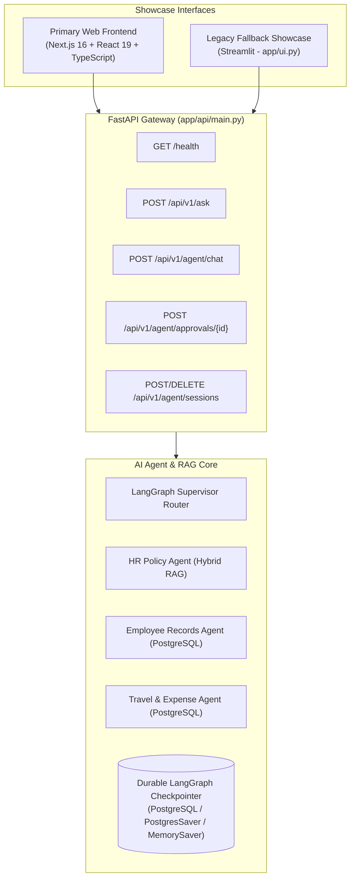

# Enterprise Support AI Agent — Live Recruiter & Technical Showcase Guide

This guide provides an end-to-end walkthrough for demonstrating the **Enterprise Support AI Agent** in live recruiter interviews, technical reviews, and engineering showcases.

---

## 1. System Architecture Overview



---

## 2. Prerequisites & Quickstart

### Step 1: Initialize Database (if using PostgreSQL)
Ensure your PostgreSQL database service is running with your `.env` configuration:
```powershell
python -c "from app.database import init_db, seed_db; init_db(); seed_db()"
```

### Step 2: Launch the FastAPI Backend Service
Start the FastAPI REST gateway on port 8000:
```powershell
uvicorn app.api.main:app --reload --port 8000
```
Verify the API is live at [http://127.0.0.1:8000/docs](http://127.0.0.1:8000/docs).

### Step 3: Launch the Primary Frontend (Next.js)
In a separate terminal window, start the Next.js showcase web application:
```powershell
cd frontend
npm run dev
```
Open [http://localhost:3000](http://localhost:3000) in your browser.

*(Optional Legacy Fallback: You can also launch the Streamlit demo via `streamlit run app/ui.py` at `http://localhost:8501`)*

---

## 3. Live Demonstration Script

### Demo Flow 1: Grounded Policy Q&A (Policy Assistant Mode)
1. In the sidebar, select **Policy Assistant** mode.
2. Click the suggested example **"✈️ Meal Per Diem"** or enter:
   > *"What is the meal per diem allowance for domestic travel?"*
3. **What to highlight to recruiters/interviewers**:
   - **Grounded Answer**: Returns the exact daily domestic meal per diem rate ($75/day).
   - **Deterministic Citations**: Expand the citations below the answer to highlight:
     - Exact source file (`travel_policy.md`)
     - Unique chunk ID (`chunk_travel_policy_1`)
     - Cross-encoder reranker score ($> 2.5$)
     - Supporting snippet verbatim from the source.

---

### Demo Flow 2: Strict "I Don't Know" Refusal Behavior
1. In **Policy Assistant** mode, click the suggested example **"🚫 Policy Refusal"** or enter:
   > *"What is the company pet insurance reimbursement policy?"*
2. **What to highlight to recruiters/interviewers**:
   - **Zero Hallucinations**: Cross-encoder relevance thresholding drops all low-confidence chunks before LLM generation.
   - **Visual Refusal Box**: Displays a clear yellow **Knowledge Base Refusal** card stating that the information is unavailable in internal documents.

---

### Demo Flow 3: Structured Operational Data & Tool Calling (AI Agent Mode)
1. In the sidebar, switch to **AI Agent** mode.
2. Click **"👤 Employee Profile"** or enter:
   > *"Show employee E1001's information."*
3. **What to highlight to recruiters/interviewers**:
   - **LangChain Tool Calling**: The agent identifies the query domain and invokes `get_employee(employee_id='E1001')`.
   - **PostgreSQL Data**: Returns Alice Chen's job title, department (Engineering), email, and direct manager hierarchy.
   - **Visual Workflow Timeline**: Shows the supervisor dispatching `Employee Records Worker` and synthesizing the answer.

---

### Demo Flow 4: Multi-Turn Conversational Memory & Context Resolution
1. Continuing immediately in the same session, enter a follow-up inquiry:
   > *"How many annual leave days do they have left?"*
2. Then ask:
   > *"How much have they spent on travel?"*
3. **What to highlight to recruiters/interviewers**:
   - **Session State Isolation**: The agent uses in-memory session history to automatically resolve `"they"` as `E1001` without requiring the user to retype the ID.
   - **Intra-Domain Multi-Step**: Successfully queries `get_leave_balance` followed by `get_travel_summary`.

---

### Demo Flow 5: Cross-Domain Multi-Agent Workflow (SQL + RAG)
1. In **AI Agent** mode, click **"🔄 Multi-Domain"** or enter:
   > *"How much has E1001 spent on travel and what is the domestic meal allowance?"*
2. **What to highlight to recruiters/interviewers**:
   - **Supervisor Orchestration**: Demonstrates multi-step cross-domain coordination:
     1. Supervisor routes to `Travel & Expense Worker` (`get_travel_summary`)
     2. Supervisor routes to `HR Policy Worker` (`ask_policy`)
     3. Supervisor concludes with `finish` and synthesizes the unified answer.
   - **Combined Citations**: Grounded policy citations appear alongside tabular PostgreSQL expense analytics.

---

### Demo Flow 6: Human-in-the-Loop (HITL) Controlled Approval
1. In **AI Agent** mode, click **"🛡️ Sensitive Approval"** or enter:
   > *"Show confidential salary and compensation records for employee E1000."*
2. **What to highlight to recruiters/interviewers**:
   - **Deterministic Security Gate**: The supervisor intercepts the restricted executive ID / sensitive keyword before calling any tools.
   - **Interactive Approval Card**: An amber card appears with Approval ID, target worker, and **Approve** / **Reject** buttons.
   - **Durable Checkpointing**: Workflow state is paused and persisted via LangGraph checkpointer.
   - Click **✅ Approve Action**: The workflow resumes, executes the authorized query, and presents the completed result.
   - (Alternatively, test **❌ Reject Action** to show safe termination with zero database leaks).

---

### Demo Flow 7: Session Lifecycle Controls
1. In the sidebar, demonstrate the session buttons:
   - **"➕ New"**: Instantly generates a clean session ID (`session-XXXXXXXX`).
   - **"🧹 Clear"**: Calls `POST /api/v1/agent/sessions/{id}/clear` to reset conversational memory while maintaining the session ID.
   - **"🗑️ Delete Session from Backend"**: Calls `DELETE /api/v1/agent/sessions/{id}` to purge all in-memory history and database checkpoints.

---

## 4. Key Takeaways for Technical Interviewers

| Engineering Requirement | How It Is Implemented & Demonstrated |
|---|---|
| **Separation of Concerns** | Client interfaces (Next.js web app & Streamlit) communicate strictly via HTTP REST API (`EnterpriseApiClient`) with zero business logic duplicated in the UI. |
| **Grounded Provenance** | Every policy assertion is linked to chunk UID, reranker score, and document metadata. |
| **Strict Security Boundaries** | Sandboxed worker tools prevent unauthorized queries; deterministic HITL gates intercept sensitive data. |
| **Fault Tolerance & Reliability** | In-run duplicate tool call suppression, cycle detection, and sanitized error reporting. |
| **Durable Asynchronous Workflows** | LangGraph PostgreSQL checkpointing allows long-running approval workflows to survive server restarts. |
