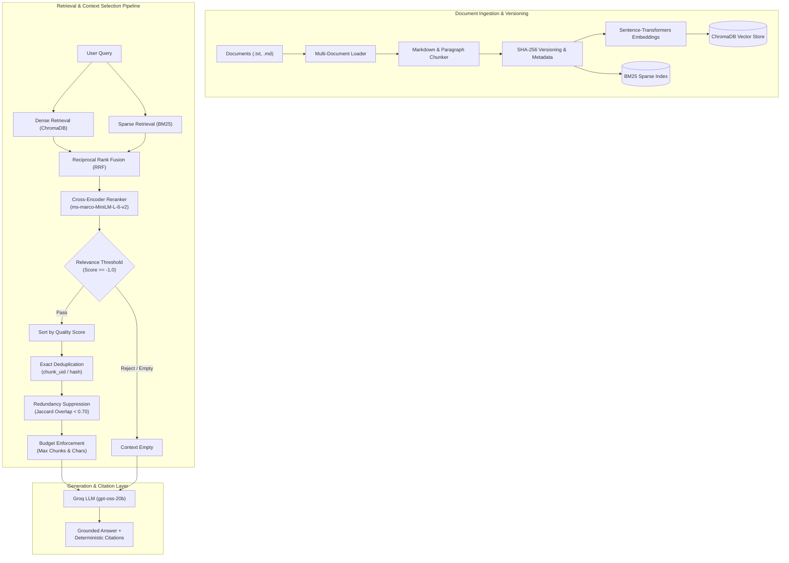
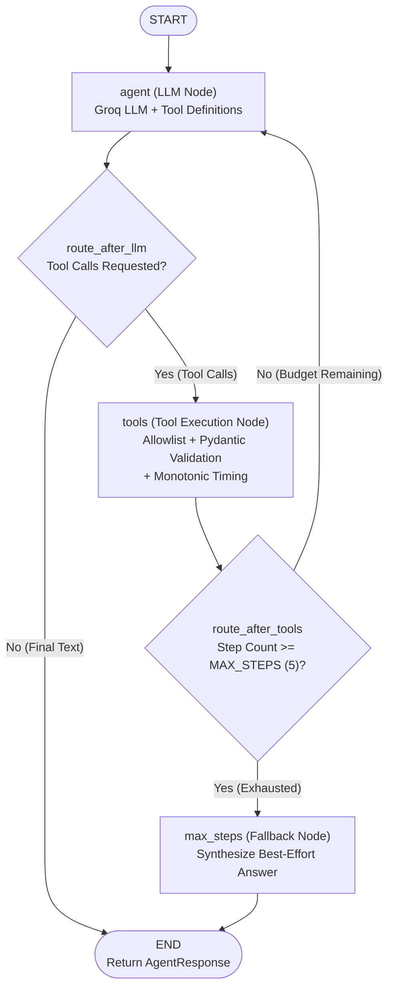
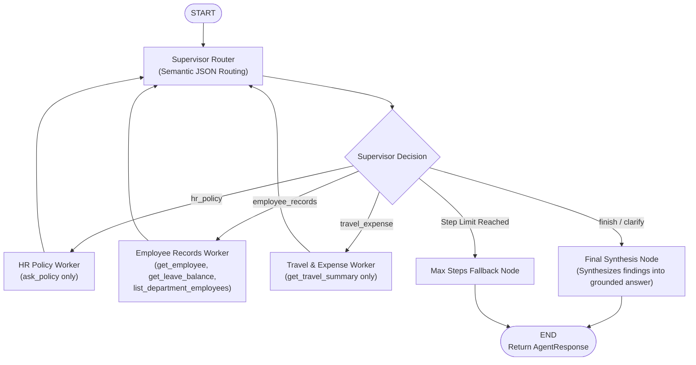
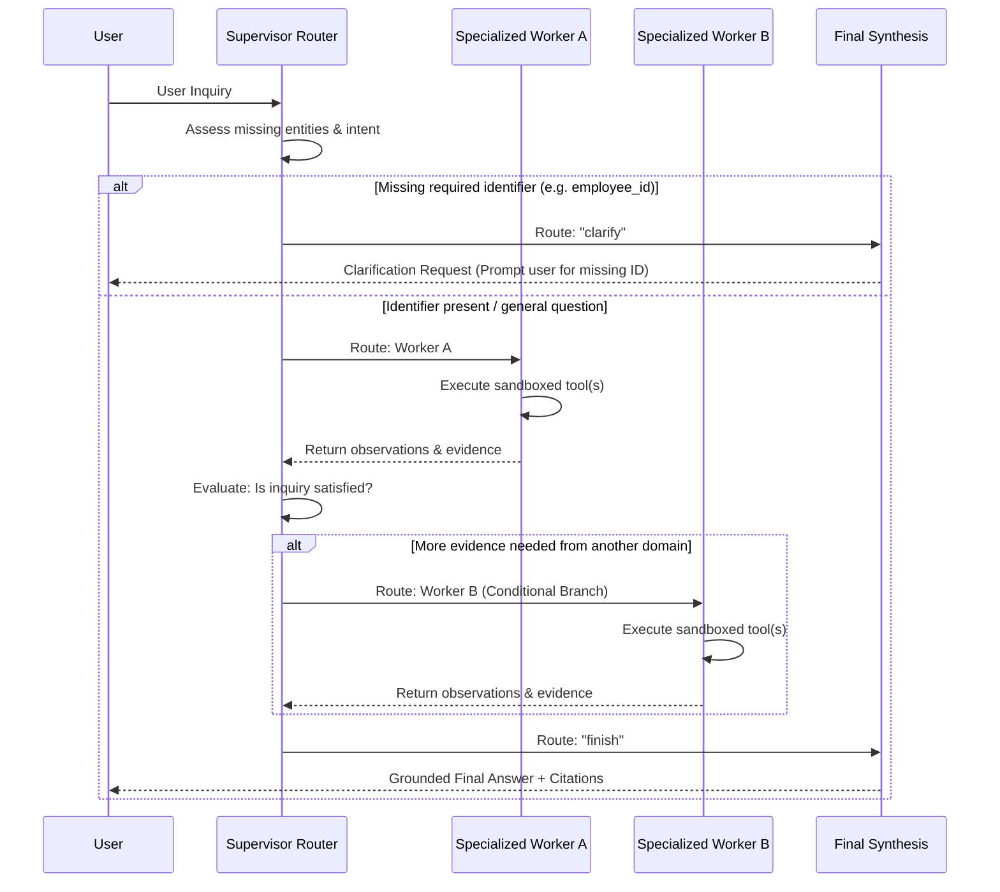
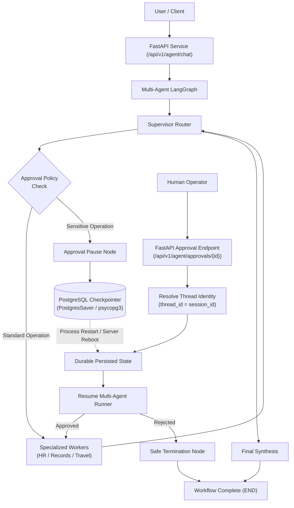
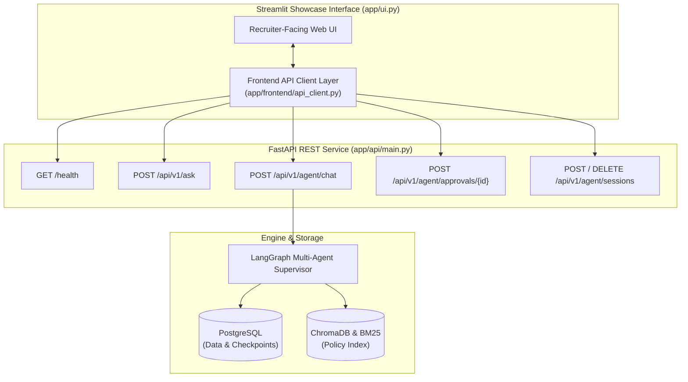

# Enterprise Support AI Agent

Employees often face delays and frustration finding authoritative answers across disparate internal company policies, travel guidelines, and employee handbooks. This project addresses that challenge by implementing an enterprise-grade Retrieval-Augmented Generation (RAG) system built from scratch in Python. The core engineering goal is to deliver verifiable, grounded answers with deterministic source citations, tight context budgeting, and reliable refusal behavior whenever the internal knowledge base lacks sufficient evidence.

---

## Key Features

* **Multi-Document Ingestion**: Ingests multiple `.txt` and `.md` policy documents with metadata extraction.
* **Incremental Ingestion & Versioning**: SHA-256 content hashing detects modified files, skips unchanged documents, and replaces outdated chunk collections.
* **Advanced Chunking**: Markdown header-aware, paragraph-preserving text chunker with configurable token-size targets and boundary overlap.
* **Dense Semantic Retrieval**: Vector embeddings generated via `sentence-transformers/all-MiniLM-L6-v2` stored in ChromaDB with cosine similarity.
* **Sparse Keyword Retrieval**: In-memory BM25Okapi search engine supporting exact alphanumeric codes, policy numbers, and acronyms.
* **Reciprocal Rank Fusion (RRF)**: Deterministic score-independent fusion combining dense and sparse ranking lists.
* **Cross-Encoder Reranking**: Second-stage reranker (`cross-encoder/ms-marco-MiniLM-L-6-v2`) scoring query-chunk relevance via joint cross-attention.
* **Metadata Filtering**: Support for pre-retrieval filtering by document ID, source file, or custom tags.
* **Relevance Thresholding**: Cross-encoder logit filtering (`rerank_threshold = -1.0`) rejecting low-confidence passages.
* **Deterministic Context Selection**: Context compression layer ordering candidates strictly by quality without non-deterministic LLM summarizers.
* **Deduplication & Redundancy Suppression**: Exact chunk deduplication plus word-set Jaccard similarity filtering to eliminate near-duplicate passages.
* **Context Budget Enforcement**: Enforces hard caps on both chunk count (`final_context_k`) and cumulative character size (`max_context_chars`).
* **Grounded Generation**: System prompt enforcing strict synthesis only from provided evidence via Groq's high-speed inference API.
* **Deterministic Provenance & Citations**: Tracks `document_id`, `chunk_id`, and `title` throughout the pipeline to cite verifiable sources.
* **"I Don't Know" Refusal Behavior**: Deterministically refuses out-of-domain or unanswerable queries when context is empty or below threshold.
* **Automated Retrieval & RAG Evaluation**: Evaluates Recall@K, Precision@K, Faithfulness, Answer Relevance, and Citation Correctness.
* **Tiered Automated Test Architecture**: 36 backend test suites and 29 frontend test suites (640+ tests across Tier A deterministic logic, Tier B local integration, Tier C live evaluation, Tier D performance benchmarks, and Next.js React Testing Library).

---

## Architecture



---

## Why This Is More Than a Basic RAG Chatbot

1. **Hybrid Retrieval**: Combines semantic embedding search (conceptual meaning) with BM25 lexical search (exact acronyms, numbers, and policy codes).
2. **Two-Stage Reranking**: First stage casts a wide candidate net at low latency; second-stage cross-encoder evaluates full query-document interactions to eliminate false positives.
3. **Context Selection & Budgeting**: Rather than dumping all retrieved chunks into the prompt, the pipeline deterministically prunes duplicates, suppresses redundant text, and enforces strict character limits.
4. **Deterministic Provenance**: Source metadata is preserved across all transformations, enabling transparent, tamper-proof citations down to the chunk index.
5. **Rigorous Evaluation**: Built-in evaluation harnesses measure retrieval recall and precision alongside generation faithfulness and answer relevance.
6. **Explicit Refusal Handling**: Stops unanswerable questions at the retrieval threshold stage, preventing hallucinations before generation even begins.

---

## Evaluation

The retrieval and context pipeline was benchmarked across three candidate pool configurations on a multi-document evaluation dataset containing both domain policy queries and unanswerable edge cases:

| Configuration | Parameters (Dense / Sparse / Rerank / Final) | Recall@K | Precision@K | Faithfulness | Answer Relevance | Citation Integrity | Retrieval Latency | Total Pipeline Latency | Chunks Sent (Avg) |
|---|---|---|---|---|---|---|---|---|---|
| **Small Pool** | `k=3, s=3, rerank=5, final=2, chars=800` | **100.0%** | **1.00** | **1.00** | **1.00** | **1.00** | 61.8 ms | **613.3 ms** | 0.8 |
| **Medium Pool (Showcase V1 Default)** | `k=10, s=10, rerank=10, final=3, chars=1500` | **100.0%** | **1.00** | **1.00** | **1.00** | **1.00** | 93.3 ms | 1575.3 ms | 0.8 |
| **Large Pool** | `k=20, s=20, rerank=20, final=5, chars=3000` | **100.0%** | **1.00** | 0.89 | **1.00** | **1.00** | 93.4 ms | 2460.3 ms | 0.8 |

### Key Benchmark Observations & Engineering Takeaway
* **Context Dilution**: The Large candidate pool did **not** improve Recall (which was already 100% on this benchmark) but increased total pipeline latency by **~56%** (from 1,575 ms to 2,460 ms). Furthermore, Faithfulness decreased to 0.89 due to attention dilution over unnecessary context.
* **Why Context Selection Matters**: Expanding context windows or candidate pools blindly degrades both latency and factual precision. Bounded candidate selection with relevance thresholding yields faster and more reliable generations.

---

## Retrieval Pipeline

### 1. Dense Retrieval
Uses `sentence-transformers/all-MiniLM-L6-v2` to produce 384-dimensional dense embeddings stored in ChromaDB under cosine distance. Captures semantic intent and paraphrased queries.

### 2. Sparse Retrieval
An in-memory BM25Okapi engine tokenizes text while preserving alphanumeric codes, policy numbers (e.g., `POL-101`), and acronyms that dense models frequently miss.

### 3. Hybrid Fusion
Reciprocal Rank Fusion (RRF with $k=60$) merges dense and sparse rankings into a unified score:
$$RRF(d) = \sum_{m \in M} \frac{1}{k + r_m(d)}$$

### 4. Cross-Encoder Reranking
Passes top fused candidates through `cross-encoder/ms-marco-MiniLM-L-6-v2`, scoring full cross-attention query-chunk pairs. Chunks failing the relevance threshold (`score < -1.0`) are dropped.

### 5. Context Selection & Compression
* **Exact Deduplication**: Drops duplicate chunks by `chunk_uid` and SHA-256 content hash.
* **Redundancy Suppression**: Calculates token-set Jaccard similarity against already accepted chunks; discards lower-ranked chunks if overlap exceeds 0.70.
* **Budget Cap**: Enforces `final_context_k` and `max_context_chars`, clipping cleanly if a chunk exceeds the remaining character allotment.

### 6. Grounded Generation
Groq API (`openai/gpt-oss-20b`) generates the response strictly constrained by the provided context. If no chunks survive filtering, the model returns a standard refusal.

### 7. Citations & Provenance
Every accepted chunk retains its `document_id`, `title`, and `chunk_id`. Citations are formatted deterministically below the response.

---

## Evaluation Methodology

The automated evaluation harness separates deterministic checks from model-based scoring:

* **Retrieval Quality (Deterministic)**: Measures Recall@K and Precision@K by comparing retrieved chunk IDs against ground-truth relevant chunk IDs.
* **Citation Integrity (Deterministic)**: Verifies that every cited chunk ID corresponds to an actual chunk passed in the retrieved context.
* **Faithfulness / Groundedness (LLM-as-Judge)**: Analyzes the generated answer against the retrieved evidence to detect unsupported claims or hallucinations.
* **Answer Relevance (LLM-as-Judge)**: Assesses whether the response directly answers the user's specific prompt.
* **Refusal Accuracy**: Verifies that out-of-domain or unanswerable queries cleanly refuse without fabricating facts.

> [!NOTE]
> The current benchmark is evaluated on an internal project benchmark dataset designed to validate pipeline functionality and edge cases. It should not be interpreted as a claim of universal enterprise benchmark performance across arbitrary domains.

---

## Example Interactions

### 1. Grounded Policy Query
```text
User: What is the meal per diem allowance for domestic travel?

Retrieved Context:
[1] Corporate Travel and Expense Policy (chunk 2)
Score: 8.421
"The company provides a meal per diem allowance of $75 per travel day for domestic travel and $100 per day for international travel. Itemized receipts are required for all meal expenses."

AI Answer:
The company provides a meal per diem allowance of $75 per travel day for domestic travel ($100 per day for international travel). Itemized receipts are required for all meal expenses.

Sources:
[1] Corporate Travel and Expense Policy (chunk 2)
```

### 2. Unanswerable Out-of-Domain Query
```text
User: What is our maternity leave policy?

Retrieved Context:
(All candidates filtered out below rerank threshold: score < -1.0)

AI Answer:
I am sorry, but the requested information is not available in the provided documents.

Sources:
(None - Query refused due to insufficient evidence)
```

---

## Tech Stack

* **Language**: Python 3.10+
* **LLM**: Groq API (`openai/gpt-oss-20b` via OpenAI Python SDK client)
* **Embeddings**: Sentence-Transformers (`all-MiniLM-L6-v2`)
* **Vector Database**: ChromaDB (persistent local client, cosine distance metric)
* **Sparse Retrieval**: Custom BM25Okapi implementation with code/abbreviation tokenization
* **Reranking**: Sentence-Transformers Cross-Encoder (`cross-encoder/ms-marco-MiniLM-L-6-v2`)
* **Context Selection**: Custom deterministic deduplication, Jaccard overlap suppression, and character budgeting
* **Evaluation**: Automated evaluation framework with deterministic metrics and LLM-as-judge scoring
* **Testing**: Python standard library `unittest` and custom master test runner

---

## Project Structure

```text
enterprise-support-ai-agent/
│
├── app/
│   ├── __init__.py               # Package marker
│   ├── config.py                 # Environment variable loader (.env)
│   ├── llm.py                    # Groq API client configuration
│   ├── document_loader.py        # Multi-document (.txt, .md) file reader with metadata
│   ├── chunker.py                # Header-aware, paragraph-preserving text chunker
│   ├── embeddings.py             # SentenceTransformer embedding wrapper
│   ├── vector_store.py           # ChromaDB client, indexing, and vector query methods
│   ├── bm25.py                   # In-memory BM25Okapi sparse search engine
│   ├── fusion.py                 # Reciprocal Rank Fusion (RRF) algorithm
│   ├── reranker.py               # Cross-Encoder scoring and threshold filtering
│   ├── context_config.py         # RetrievalContextConfig dataclass and preset pools
│   ├── context_selector.py       # Deterministic deduplication, Jaccard redundancy, and budgeting
│   ├── retriever.py              # Unified hybrid retrieval pipeline orchestrator
│   ├── rag.py                    # Grounded prompt construction and answer generator
│   ├── ingestion.py              # Incremental ingestion engine with SHA-256 hashing
│   ├── ingest.py                 # CLI entry point for document ingestion
│   ├── conversation.py           # Multi-turn conversational memory tracker
│   ├── evaluation.py             # Deterministic and LLM-judge evaluation functions
│   ├── ui.py                     # Streamlit interactive Showcase V1 browser interface
│   └── main.py                   # Interactive terminal chat CLI loop
│
├── data/
│   ├── chroma/                   # Persistent ChromaDB vector database files
│   └── documents/                # Enterprise knowledge base documents
│       ├── attendance_policy.txt # Hours, remote work, core collaboration hours
│       ├── benefits_policy.txt   # Health insurance, 401(k) match, wellness stipend
│       ├── leave_policy.txt      # Annual leave, carry forward rules, approval process
│       └── travel_policy.md      # Travel authorization, flights, per diem allowances
│
├── tests/
│   ├── run_all_tests.py          # Master test runner executing all 14 test suites
│   ├── test_document_loader.py   # Loader unit tests
│   ├── test_multi_doc_loader.py  # Multi-document and metadata tests
│   ├── test_chunker.py           # Chunking and boundary tests
│   ├── test_embeddings.py        # Embedding dimension and sanity tests
│   ├── test_reranker.py          # Cross-encoder scoring and thresholding tests
│   ├── test_retrieval_filtering.py # Distance and threshold filtering tests
│   ├── test_retrieval_cases.py   # Edge case and unanswerable query retrieval tests
│   ├── test_hybrid_search.py     # BM25, vector search, and RRF fusion tests
│   ├── test_hybrid_evaluation.py # Hybrid search benchmark vs dense/sparse baselines
│   ├── test_context_selection.py # Deduplication, Jaccard redundancy, and budget limit tests
│   ├── test_top_k_benchmark.py   # Small vs Medium vs Large pool comparative benchmark
│   ├── test_rag.py               # End-to-end RAG answer and citation generation
│   ├── test_rag_evaluation.py    # Automated quality thresholds and LLM-as-judge evaluation
│   └── test_ui_integration.py    # UI pipeline integration tests across scenarios
│
├── .env                          # Local secrets (GROQ_API_KEY)
├── requirements.txt              # Project dependencies (including streamlit)
└── README.md                     # System documentation & setup guide
```

---

## Installation & Quickstart

### Prerequisites
* Windows (or Linux/macOS) with Python 3.10 or higher
* Groq API Key (available free at [console.groq.com](https://console.groq.com))

### 1. Clone the Repository
```powershell
git clone https://github.com/your-username/enterprise-support-ai-agent.git
cd enterprise-support-ai-agent
```

### 2. Create and Activate Virtual Environment
```powershell
python -m venv .venv
.\.venv\Scripts\Activate.ps1
```
*(If PowerShell restricts script execution, run `Set-ExecutionPolicy -Scope Process -ExecutionPolicy Bypass` first)*

### 3. Install Dependencies
```powershell
pip install -r requirements.txt
```

### 4. Configure Environment Variables
Create a `.env` file in the project root:
```env
GROQ_API_KEY=gsk_your_actual_groq_api_key_here
```

### 5. Ingest Knowledge Base Documents
Ingest all policy files from `data/documents/` into ChromaDB and the BM25 index:
```powershell
python -m app.ingest
```

### 6. Run the Application
To launch the **Interactive Showcase V1 Browser Demo**:
```powershell
streamlit run app/ui.py
```
*(Runs locally at `http://localhost:8501`)*

To run an interactive multi-turn terminal session:
```powershell
python -m app.main
```

To run a single grounded RAG query with retrieved context and citations:
```powershell
python -m tests.test_rag
```

---

## Interactive Showcase V1 Browser Demo

The project includes a clean, recruiter-facing interactive browser demonstration built in Streamlit. It connects directly to the frozen RAG core without duplicating retrieval logic or introducing unnecessary production overhead.

### Key Demo Capabilities:
1. **Grounded Question Answering**: Users can enter custom questions or select pre-loaded policy questions.
2. **Deterministic Source Cards**: Visually correlates every generated claim to its source file, chunk UID, and cross-encoder reranking score.
3. **Retrieval Transparency & Metrics**: An expandable *Retrieval Details* panel exposes live retrieval latency, total end-to-end pipeline latency, initial vs. final chunk counts, and context character compression percentages.
4. **Reliable Refusal**: Questions that cannot be answered from the knowledge base trigger a distinct refusal box without hallucinating.

### Example Showcase Queries:
* **Travel Policy**: *"What is the meal per diem allowance for domestic travel?"* (Answers $75 per domestic day with source `travel_policy.md`).
* **401(k) Benefits**: *"How much does the company match 401(k) contributions?"* (Answers 100% match up to 4% base salary with source `benefits_policy.txt`).
* **Attendance Hours**: *"What are the core collaboration hours for remote employees?"* (Answers 10:00 AM to 4:00 PM local time with source `attendance_policy.txt`).
* **Unanswerable Query**: *"What is the company pet insurance reimbursement policy?"* (Refuses cleanly: *"I am sorry, but the requested information is not available in the provided documents."*).

```text
+-----------------------------------------------------------------------------------+
|  Enterprise Support AI Agent                                                      |
|  Grounded enterprise policy assistant powered by hybrid retrieval and RAG         |
+-----------------------------------------------------------------------------------+
|  [ ✈️ Travel Policy ] [ 💰 401(k) Benefits ] [ 🕒 Attendance ] [ 🚫 Unanswerable ] |
+-----------------------------------------------------------------------------------+
|  Enter your question: [ What is the meal per diem allowance for domestic travel? ] |
|  [ Ask Agent ]                                                                    |
+-----------------------------------------------------------------------------------+
|  Answer:                                                                          |
|  The company provides a meal per diem allowance of $75 per travel day...         |
+-----------------------------------------------------------------------------------+
|  Sources:                                                                         |
|  [1] Cited Source: Corporate Travel and Expense Policy                            |
|      File: data/documents/travel_policy.md | Chunk: travel_policy_chunk_2         |
+-----------------------------------------------------------------------------------+
|  [>] Retrieval Details & Engineering Metrics                                      |
|      Retrieval: HYBRID | Ret Latency: 75.2 ms | Reduction: 0.0% (1 -> 1 chunks)   |
+-----------------------------------------------------------------------------------+
```

*(UI Screenshot placeholder: Add `docs/assets/showcase_v1_demo.png` for visual presentation).*

---

## Phase 3: Structured Operational Data Layer (PostgreSQL)

In an enterprise support environment, inquiries span two fundamental data modalities:
1. **Unstructured Knowledge**: Company policies, employee handbooks, travel guidelines, and benefit summaries (handled via the hybrid RAG pipeline).
2. **Structured Operational Records**: Specific employee profile data, remaining paid-time-off (PTO) balances, and submitted travel expense vouchers (handled via PostgreSQL).

### Schema Overview

The database foundation defines three normalized tables with relational integrity, foreign keys, and indexes:

```text
+-----------------------------------------------------------------------------------+
|                                    employees                                      |
+-----------------------------------------------------------------------------------+
| id                  : SERIAL PRIMARY KEY                                          |
| employee_id         : VARCHAR(32) UNIQUE NOT NULL  (e.g., 'E1001')                 |
| name                : VARCHAR(128) NOT NULL                                       |
| email               : VARCHAR(256) UNIQUE NOT NULL                                |
| department          : VARCHAR(64) NOT NULL                                        |
| job_title           : VARCHAR(128) NOT NULL                                       |
| manager_employee_id : VARCHAR(32) REFERENCES employees(employee_id)               |
| created_at          : TIMESTAMPTZ DEFAULT NOW() NOT NULL                          |
+-----------------------------------------------------------------------------------+
                                          |
                   +----------------------+----------------------+
                   | 1:N                                         | 1:N
                   v                                             v
+------------------------------------+   +------------------------------------------+
|           leave_balances           |   |             travel_expenses              |
+------------------------------------+   +------------------------------------------+
| id             : SERIAL PRIMARY KEY|   | id           : SERIAL PRIMARY KEY        |
| employee_id    : VARCHAR(32) FK    |   | employee_id  : VARCHAR(32) FK            |
| leave_type     : VARCHAR(64) NOT NULL| | expense_date : DATE NOT NULL             |
| total_days     : NUMERIC(5, 1)     |   | category     : VARCHAR(64) NOT NULL      |
| used_days      : NUMERIC(5, 1)     |   | amount       : NUMERIC(10, 2) NOT NULL   |
| remaining_days : NUMERIC(5, 1) GEN |   | currency     : VARCHAR(3) DEFAULT 'USD'  |
| updated_at     : TIMESTAMPTZ       |   | status       : VARCHAR(32) DEFAULT 'sub' |
| (UQ: employee_id, leave_type)      |   | description  : TEXT NOT NULL             |
+------------------------------------+   | created_at   : TIMESTAMPTZ               |
                                         +------------------------------------------+
```

### Safe Application Query Layer (`app/database/repository.py`)

All database operations are abstracted behind safe, parameterized repository functions. Direct string formatting or raw SQL concatenation is strictly forbidden.

#### Available Query Operations:
* **Employees**:
  * `get_employee_by_id(employee_id)`: Fetches an employee record by business ID.
  * `get_employee_by_email(email)`: Case-insensitive employee lookup by email.
  * `list_employees_by_department(department)`: Lists employees belonging to a department.
  * `get_employee_manager(employee_id)`: Retrieves the direct manager's profile.
* **Leave Balances**:
  * `get_leave_balances(employee_id)`: Fetches all leave categories for an employee.
  * `get_leave_balance_by_type(employee_id, leave_type)`: Retrieves a specific balance (`annual`, `sick`).
* **Travel Expenses**:
  * `get_travel_expenses(employee_id, status=None)`: Retrieves expenses with optional status filtering.
  * `get_travel_expenses_by_status(employee_id, status)`: Fetches expenses by status (`approved`, `submitted`, `reimbursed`).
  * `get_total_travel_expenses(employee_id, status=None)`: Aggregates total expenditure.
  * `get_travel_expenses_in_date_range(employee_id, start_date, end_date)`: Filters expenses between dates.

### Why Use a Dedicated Query Layer Instead of Scattering SQL?

1. **Security & SQL Injection Prevention**: Centralizing query execution ensures all database calls utilize parameterized inputs (`%s`), preventing SQL injection attacks regardless of user input.
2. **Decoupled Architecture**: Application business logic, future REST APIs (FastAPI), and AI agent tool definitions remain decoupled from low-level SQL syntax and schema changes.
3. **Consistent Error Handling & Sanitization**: Database exceptions are caught and wrapped in `DatabaseError`, ensuring database passwords, connection strings, or host details are never leaked to client logs.
4. **Testability**: An isolated test database (`enterprise_support_test`) can be used for automated testing without risking or polluting production/developer data.

### Database Setup & Testing

#### 1. Configure `.env`
```env
DB_HOST=localhost
DB_PORT=5432
DB_NAME=enterprise_support
DB_USER=postgres
DB_PASSWORD=postgres
```

#### 2. Seed Deterministic Development Data
```powershell
python -m app.database.seed
```

#### 3. Run Database Test Suite
```powershell
python -m unittest tests.test_database
```

---

## Phase 4: FastAPI Service Layer & REST Endpoints

The project provides a production-grade REST API built with FastAPI that unifies unstructured RAG policy question answering and PostgreSQL structured enterprise records behind a single service boundary.

```text
                           Client Applications (Web / Mobile / AI Agents)
                                                  │
                                                  ▼
                                      FastAPI Gateway (Port 8000)
                                      ├── OpenAPI Docs (/docs)
                                      ├── CORS Middleware
                                      └── Sanitized Exception Handlers
                                                  │
                         ┌────────────────────────┴────────────────────────┐
                         ▼                                                 ▼
             RAG Service Layer (/api/v1/ask)             SQL Service Layer (/api/v1/employees/...)
                         │                                                 │
            ┌────────────┴────────────┐                                    ▼
            ▼                         ▼                               PostgreSQL
   ChromaDB + BM25Okapi      Groq LLM (Grounded)                 (employees, leave_balances,
     (Hybrid Search)        (openai/gpt-oss-20b)                      travel_expenses)
```

### Running the API Server

```powershell
# Launch the FastAPI development server with auto-reload
uvicorn app.api.main:app --reload
```
* **Interactive Swagger UI**: `http://localhost:8000/docs`
* **ReDoc Documentation**: `http://localhost:8000/redoc`
* **Raw OpenAPI Specification**: `http://localhost:8000/openapi.json`

### REST Endpoints Reference

#### 1. System Health (`GET /health`)
* **Request**: `GET /health`
* **Response** (`200 OK`):
  ```json
  {
    "status": "healthy",
    "version": "1.0.0"
  }
  ```

#### 2. Grounded Policy Question Answering (`POST /api/v1/ask`)
Executes the hybrid retrieval pipeline (Dense + BM25 + Cross-Encoder Reranker) and returns a grounded answer with deterministic source citations.
* **Request**: `POST /api/v1/ask`
  ```json
  {
    "question": "What is the meal per diem allowance for domestic travel?"
  }
  ```
* **Response** (`200 OK`):
  ```json
  {
    "question": "What is the meal per diem allowance for domestic travel?",
    "answer": "The company provides a meal per diem allowance of $75 per travel day for domestic travel.",
    "is_refusal": false,
    "sources": [
      {
        "rank": 1,
        "title": "Corporate Travel and Expense Policy",
        "source_file": "data/documents/travel_policy.md",
        "chunk_uid": "travel_policy_chunk_2",
        "rerank_score": 8.421,
        "snippet": "The company provides a meal per diem allowance of $75 per travel day for domestic travel..."
      }
    ]
  }
  ```

#### 3. Employee Profile & Manager Lookup (`GET /api/v1/employees/{employee_id}`)
Retrieves employee information and resolves the organizational reporting line via a relational self-JOIN.
* **Request**: `GET /api/v1/employees/E1001`
* **Response** (`200 OK`):
  ```json
  {
    "employee_id": "E1001",
    "name": "Alice Chen",
    "email": "alice.chen@enterprise.internal",
    "department": "Engineering",
    "job_title": "Senior Software Engineer",
    "created_at": "2026-09-12T11:06:56.550827Z",
    "manager": {
      "employee_id": "E1004",
      "name": "David Kim",
      "email": "david.kim@enterprise.internal",
      "job_title": "VP of Operations"
    }
  }
  ```

#### 4. Employee Leave Balances (`GET /api/v1/employees/{employee_id}/leave`)
Aggregates total PTO allocated, used, and remaining, along with an itemized category breakdown.
* **Request**: `GET /api/v1/employees/E1001/leave`
* **Response** (`200 OK`):
  ```json
  {
    "employee_id": "E1001",
    "name": "Alice Chen",
    "department": "Engineering",
    "total_allocated_days": 34.0,
    "total_used_days": 10.0,
    "total_remaining_days": 24.0,
    "balances": [
      {
        "leave_type": "annual",
        "total_days": 24.0,
        "used_days": 8.0,
        "remaining_days": 16.0,
        "updated_at": "2026-09-12T11:06:56.550827Z"
      },
      {
        "leave_type": "sick",
        "total_days": 10.0,
        "used_days": 2.0,
        "remaining_days": 8.0,
        "updated_at": "2026-09-12T11:06:56.550827Z"
      }
    ]
  }
  ```

#### 5. Employee Travel Expense Analytics (`GET /api/v1/employees/{employee_id}/travel`)
Calculates total claim counts, approved vs pending expenditure, category rollups (`flights`, `meals`), and itemized vouchers.
* **Request**: `GET /api/v1/employees/E1001/travel`
* **Response** (`200 OK`):
  ```json
  {
    "employee_id": "E1001",
    "name": "Alice Chen",
    "department": "Engineering",
    "total_claims": 2,
    "total_amount": 425.0,
    "approved_amount": 425.0,
    "submitted_amount": 0.0,
    "reimbursed_amount": 0.0,
    "by_category": {
      "flights": 350.0,
      "meals": 75.0
    },
    "expenses": [
      {
        "id": 1,
        "expense_date": "2026-02-14",
        "category": "flights",
        "amount": 350.0,
        "currency": "USD",
        "status": "approved",
        "description": "Domestic flight to Seattle for architecture review",
        "created_at": "2026-09-12T11:06:56.550827Z"
      }
    ]
  }
  ```

### Running API Automated Tests

```powershell
python -m unittest tests.test_api
```

---

## Phase 5: LangChain Foundations & Tool Wrappers

Phase 5 establishes a **thin, standardized LangChain tool integration layer** (`app/tools/`). This layer converts existing RAG knowledge base retrieval and PostgreSQL analytical repository functions into typed, schema-validated tools ready for future agent consumption.

```text
Existing Application Logic
        │
        ├── RAG Functions (Hybrid Search + Cross-Encoder + Grounded LLM)
        │
        └── PostgreSQL Repository Functions (Parameterized SQL Queries)
                ↓
        LangChain Tool Wrappers (app/tools/)
        ├── ask_policy(question: str)
        ├── get_employee(employee_id: str)
        ├── get_leave_balance(employee_id: str)
        ├── get_travel_summary(employee_id: str)
        └── list_department_employees(department: str)
                ↓
        Future AI Agent (ReAct / LangGraph)
```

### Why LangChain?

LangChain is utilized strictly as an **integration layer**, not as an architectural rewrite. At this stage, LangChain provides:

1. **Standardized Tool Interface**: Uniform `BaseTool` / `@tool` contract (`.invoke(input_dict)`, `.name`, `.description`, `.args_schema`) allowing future agents or LLM function-calling protocols (OpenAI, Groq, Anthropic) to discover and invoke capabilities seamlessly.
2. **Typed Pydantic Schemas**: Strict parameter definitions (`PolicyQuestionInput`, `EmployeeIdInput`, `DepartmentInput`) that automatically produce JSON Schema definitions for LLM tool selection and validate arguments before reaching core code.
3. **Rich Semantic Tool Descriptions**: Explicit prompt descriptions detailing *what* the tool does, *when* an agent should call it, and *what it does not do*, preventing agent misuse and routing collisions.
4. **Agent-Ready Serialization**: Ensures all outputs (dates, timestamps, Decimals) are fully JSON-serializable dictionaries with rich context, structured citations, and explicit `found` / `status` indicators.

### What LangChain is NOT Replacing

To maintain high reliability, deterministic safety, and zero regression, LangChain **does not replace**:
* ❌ **Our RAG Pipeline**: Embeddings, ChromaDB dense search, BM25 sparse search, Reciprocal Rank Fusion (RRF), Cross-Encoder reranking, and deterministic context selection remain completely intact in `app/retriever.py` and `app/rag.py`.
* ❌ **PostgreSQL Repository**: ACID transaction safety, relational joins, aggregations, and parameterized SQL queries remain in `app/database/repository.py`.
* ❌ **FastAPI Service Layer**: REST endpoints continue to serve client applications independently of LangChain tools.
* ❌ **Deterministic Citations & Grounding**: Citations with chunk UIDs, rerank scores, snippets, and strict refusal logic (`is_refusal`) are preserved unaltered.

### Tool Registry Summary

| Tool Name | Input Schema | Target Backend | Purpose & Agent Context |
|---|---|---|---|
| `ask_policy` | `question: str` | Hybrid RAG Pipeline | Answers company policy, expense limits, leave guidelines, IT security, and compliance questions with source citations. |
| `get_employee` | `employee_id: str` | PostgreSQL (`employees`) | Retrieves employee profile details and direct manager hierarchy. |
| `get_leave_balance` | `employee_id: str` | PostgreSQL (`leave_balances`) | Fetches total allocated, used, and remaining leave days across all categories. |
| `get_travel_summary` | `employee_id: str` | PostgreSQL (`travel_expenses`) | Returns aggregate travel spending, claim counts by status, and category totals. |
| `list_department_employees` | `department: str` | PostgreSQL (`employees`) | Lists all active employees and titles within a specified department. |

### Security & Error Handling Boundaries

* **Zero Arbitrary SQL**: No tools accept raw SQL strings or execute unstructured database commands. The future agent cannot perform SQL injection or arbitrary data access.
* **Sanitized Error Handling**: All tools intercept internal database exceptions (`DatabaseError`) and return clean structured error messages (`{"status": "error", "found": False}`) without exposing connection strings, passwords, or stack traces.
* **Provenance Preservation**: The `ask_policy` tool includes complete citation metadata (rank, title, source_file, chunk_uid, rerank_score, snippet).

### Running LangChain Tool Automated Tests

```powershell
python -m unittest tests.test_langchain_tools
```

---

## Phase 6: AI Agent & Multi-Turn Conversational Memory

Phase 6 implements a **transparent, controlled tool-calling agent loop** (`app/agent/`) paired with **in-memory multi-turn conversational session memory** (`app/agent/memory.py`) and a standardized **FastAPI Agent Gateway** (`POST /api/v1/agent/chat`).

```text
                                User HTTP Request
                    (session_id: "sess_101", message: "...")
                                      │
                                      ▼
                      ┌──────────────────────────────┐
                      │    FastAPI Agent Gateway     │
                      │   (POST /api/v1/agent/chat)  │
                      └──────────────┬───────────────┘
                                      │
                                      ▼
                      ┌──────────────────────────────┐
                      │    In-Memory Session Store   │
                      │   (InMemorySessionStore)     │
                      │  - Session isolation         │
                      │  - History context tracking  │
                      └──────────────┬───────────────┘
                                      │
                                      ▼
                      ┌──────────────────────────────┐
                      │    Enterprise Agent Loop     │
                      │     (app/agent/agent.py)     │
                      └──────────────┬───────────────┘
                                      │
                              (1) Tool Decision
                                      │
                                      ▼
                        ┌───────────────────────────┐
                        │   Language Model (Groq)   │
                        │   (openai/gpt-oss-20b)    │
                        └─────────────┬─────────────┘
                                      │
                              (2) Tool Calls
                                      │
                                      ▼
                  ┌───────────────────────────────────────┐
                  │   Tool Allowlist & Validation Gate    │
                  │     (Pydantic Schema Validation)      │
                  └───────────────────┬───────────────────┘
                                      │
                              (3) Safe Execution
                                      │
                ┌─────────────────────┴─────────────────────┐
                ▼                                           ▼
       ┌─────────────────┐                         ┌─────────────────┐
       │  RAG Knowledge  │                         │ SQL Operational │
       │   `ask_policy`  │                         │    Data Tools   │
       └────────┬────────┘                         └────────┬────────┘
                │                                           │
                │            (4) Observation Return         │
                └─────────────────────┬─────────────────────┘
                                      │
                                      ▼
                      ┌──────────────────────────────┐
                      │   Context-Preserved Turn     │
                      │  & Final Answer Synthesis    │
                      │     (AgentChatResponse)      │
                      └──────────────────────────────┘
```

### 1. In-Memory Conversational Session Memory

* **Session Lifecycle**: Each conversational exchange is tracked under an explicit `session_id`. New sessions initialize with an empty message list, while existing sessions retain conversational history across requests.
* **Message History Preservation**: User inquiries, assistant reasoning, tool calls, and structured tool observations are preserved within the session history. When follow-up questions containing pronouns or ambiguous references arrive (e.g., *"What about their manager?"* after querying *"What is the employee info for E1001?"*), the agent resolves context accurately from prior turns.
* **Strict Session Isolation**: Sessions are encapsulated independently within `InMemorySessionStore` guarded by a thread-safe reentrant lock (`threading.Lock()`). Messages and tool states from Session A can never leak or contaminate Session B.
* **Session Management**: Dedicated endpoints allow explicit session clearing (`POST /api/v1/agent/sessions/{session_id}/clear`) and deletion (`DELETE /api/v1/agent/sessions/{session_id}`).
* **In-Memory Architecture & Future Persistence**:
  * *Current In-Memory Design*: Fast, zero-dependency in-process dictionary storage ideal for single-instance development, automated test isolation, and rapid prototyping.
  * *Future Persistence Path*: The `SessionStore` interface is cleanly decoupled and designed to swap directly to distributed **Redis** caching or persistent **PostgreSQL** relational tables without altering agent reasoning or API schemas.

### 2. Multi-Turn Conversation Flow & Example

```text
Turn 1:
User: "What is the employee information for E1001?"
Agent: Calls `get_employee(employee_id="E1001")`
Observation: {"employee_id": "E1001", "name": "Alice Johnson", "job_title": "Senior Software Engineer", "department": "Engineering", "manager_employee_id": "E1003"}
Agent Answer: "Alice Johnson (E1001) is a Senior Software Engineer in the Engineering department, reporting to E1003."

Turn 2 (Same Session):
User: "What about their manager?"
Agent: Resolves pronoun "their" -> Alice Johnson (E1001), manager E1003. Calls `get_employee_manager(employee_id="E1001")`.
Observation: {"manager_employee_id": "E1003", "name": "Carol Danvers", "job_title": "Engineering Director", "email": "carol.danvers@company.com"}
Agent Answer: "Alice Johnson's direct manager is Carol Danvers (E1003), who is the Engineering Director."
```

### 3. Agent Reliability, Tool Routing & Lightweight Observability (Task 3)

#### Execution Trace Architecture
Every agent invocation constructs an explicit, structured `AgentExecutionTrace` capturing:
* **Session ID & Query**: Trace context for multi-turn conversations.
* **Per-Step Metadata (`AgentStep`)**: Step number (1-indexed), invoked tool name, validated input parameters, execution status (`success`, `error`, `rejected_duplicate`), measured execution duration in milliseconds, and sanitized error messages.
* **Aggregated Run Metrics**: Total tool execution steps, total turn duration in milliseconds, `used_rag` boolean flag, and list of all invoked tools.
* **Deterministic Citations**: Source citations extracted from policy knowledge retrievals.

#### Precise Tool Timing Measurement
Tool invocations and overall run lifecycles are measured with high-precision monotonic timers (`time.perf_counter()`), providing millisecond-level telemetry (`duration_ms`) without mutating underlying tool implementations.

#### Tool Routing Disambiguation Boundaries
The agent system prompt (`AGENT_SYSTEM_PROMPT`) enforces strict routing boundaries across enterprise tools:
1. `ask_policy(question)`: General company policy, handbook guidelines, per diem rates, receipt rules, leave accrual limits, working hours, remote work, equipment, and IT security standards.
2. `get_employee(employee_id)`: Individual employee official profiles, contact info, department, job title, and direct manager hierarchy.
3. `get_leave_balance(employee_id)`: Individual real-time PTO allocations, used leave days, and remaining PTO/sick/casual balances.
4. `get_travel_summary(employee_id)`: Individual travel expense claims, aggregate amounts, approved/pending totals, and category breakdowns.
5. `list_department_employees(department)`: Department team member rosters and staff counts.

#### Duplicate Tool-Call Protection & Loop Safety
To prevent accidental redundant tool executions within the same reasoning cycle, the agent maintains an in-run hash of executed `(tool_name, serialized_args)`. If an identical tool call is repeated:
* The execution is intercepted and assigned status `"rejected_duplicate"`.
* A structured observation is returned to the LLM indicating that the tool was already executed and directing it to utilize the existing observation or synthesize the final answer.
* The hard safety cap `MAX_AGENT_STEPS = 5` ensures recursive execution loops terminate safely.

#### Application-Level Observability Without External Frameworks
Logging is implemented natively via Python's standard `logging` library. Structured log entries trace:
`Agent Run Started` → `LLM Decision` → `Tool Executed (with timing)` → `Agent Run Finished`
* **PII & Credential Scrubbing**: Log outputs deliberately exclude API keys, database passwords, connection URIs, raw stack traces, and unmasked sensitive records.

### 4. FastAPI Agent REST API

#### `POST /api/v1/agent/chat`
Submits a user message to the conversational agent under a specific session.

**Request Body (`AgentChatRequest`):**
```json
{
  "session_id": "sess_12345",
  "message": "What is the meal per diem allowance for domestic travel?"
}
```

**Response Body (`AgentChatResponse`):**
```json
{
  "session_id": "sess_12345",
  "query": "What is the meal per diem allowance for domestic travel?",
  "answer": "The company provides a meal per diem allowance of $75 per travel day for domestic travel. Itemized receipts are required for all meal expenses.",
  "status": "completed",
  "steps": [
    {
      "step_number": 1,
      "tool_name": "ask_policy",
      "tool_args": {
        "question": "What is the meal per diem allowance for domestic travel?"
      },
      "tool_result": {
        "question": "What is the meal per diem allowance for domestic travel?",
        "answer": "The company provides a meal per diem allowance of $75 per travel day...",
        "is_refusal": false,
        "sources": [
          {
            "rank": 1,
            "title": "Corporate Travel and Expense Policy",
            "source_file": "data/policies/travel_policy.md",
            "chunk_uid": "chunk_travel_02",
            "rerank_score": 8.75,
            "snippet": "Meal Per Diem: Domestic travel allows up to $75 per day..."
          }
        ]
      },
      "status": "success",
      "duration_ms": 42.15,
      "error": null
    }
  ],
  "total_steps": 1,
  "duration_ms": 1150.32,
  "used_rag": true,
  "citations": [
    {
      "rank": 1,
      "title": "Corporate Travel and Expense Policy",
      "source_file": "data/policies/travel_policy.md",
      "chunk_uid": "chunk_travel_02",
      "rerank_score": 8.75,
      "snippet": "Meal Per Diem: Domestic travel allows up to $75 per day..."
    }
  ],
  "trace": {
    "session_id": "sess_12345",
    "total_steps": 1,
    "total_duration_ms": 1150.32,
    "used_rag": true,
    "status": "completed",
    "tools_invoked": ["ask_policy"]
  }
}
```

#### What the API Exposes vs. Deliberately Does NOT Expose
* **Exposed**: Session ID, query, grounded synthesized answer, execution status, step metadata (tool name, validated args, structured tool result, status, timing), total steps, run duration, RAG flag, verifiable citations, and high-level execution trace.
* **NOT Exposed (Security & Integrity Boundaries)**: Raw system prompts, internal chain-of-thought tokens, raw SQL statements, database connection credentials, third-party LLM provider internals, unmasked API keys, or raw operating system stack traces.

#### `POST /api/v1/agent/sessions/{session_id}/clear`
Resets the conversation history for an existing session without deleting the session object.

#### `DELETE /api/v1/agent/sessions/{session_id}`
Completely deletes the session and releases memory.

### 6. Phase 7 Task 1 — LangGraph Fundamentals & Single-Agent Graph Migration

#### What is LangGraph?
LangGraph is a stateful orchestration framework built on top of directed cyclic graphs. Instead of running an agent as an ad-hoc `while` loop, LangGraph models agent execution as a **StateGraph** where:
* **State** is a centralized, strongly typed dictionary passed between steps.
* **Nodes** are discrete, isolated Python functions that accept the state, execute work (such as an LLM call or tool execution), and return state updates.
* **Edges** connect nodes together to define execution flow.
* **Conditional Edges** inspect the state dynamically to decide which node to execute next.

#### Why Are We Introducing LangGraph Now?
In Phase 6, we implemented an explicit hand-rolled linear agent loop. While clean for a single agent, hand-rolled loops become difficult to maintain when expanding to complex topologies—such as multi-agent supervisor hierarchies, parallel worker agents, and human-in-the-loop validation checkpoints. Migrating our proven single-agent workflow to LangGraph now establishes a formal, testable graph architecture without altering underlying tools or safety boundaries.

#### Core LangGraph Concepts

```text
┌────────────────────────────────────────────────────────────────────────┐
│                          LangGraph Execution Model                     │
│                                                                        │
│       ┌─────────┐         ┌───────────┐         ┌──────────┐           │
│       │  State  │ ──────> │   Node    │ ──────> │ Updated  │           │
│       │  (In)   │         │ (Execute) │         │  State   │           │
│       └─────────┘         └───────────┘         └──────────┘           │
│                                                       │                │
│                                                       ▼                │
│                                             ┌───────────────────┐      │
│                                             │ Conditional Edge  │      │
│                                             │     (Routing)     │      │
│                                             └───────────────────┘      │
│                                               │               │        │
│                                          [Tools Req.]    [Final Answer]│
│                                               ▼               ▼        │
│                                          (Tool Node)        (END)      │
└────────────────────────────────────────────────────────────────────────┘
```

1. **Graph State (`AgentGraphState`)**: A typed `TypedDict` containing only the fields required for the conversational turn: `session_id`, `query`, `messages`, `step_count`, `max_steps`, `steps` metadata, `final_answer`, `status`, `used_rag`, and `citations`.
2. **Nodes**:
   * `agent` (LLM Node): Prepares prompts and conversation history, invokes the Groq LLM with bound tools, and records either a text answer or pending tool calls.
   * `tools` (Tool Node): Validates tool arguments against Pydantic schemas, executes approved tools sequentially, captures execution timing, formats observations, and catches errors safely.
   * `max_steps` (Step Exhaustion Node): Safely synthesizes an explanation if the step limit (`MAX_AGENT_STEPS = 5`) is exhausted before the LLM concludes.
3. **Edges & Conditional Edges**:
   * `START -> agent`: Initial node invocation.
   * `route_after_llm`: Inspects state; routes to `"tools"` if tool calls were requested, or `END` if a final text answer was produced.
   * `route_after_tools`: Inspects state; routes to `"max_steps"` if `step_count >= max_steps`, otherwise loops back to `"agent"`.
   * `tools -> agent` (or `max_steps`): Completes the cycle.
   * `max_steps -> END`: Graceful termination upon budget exhaustion.

#### Architecture: Single-Agent LangGraph Workflow



#### Orchestration Layer vs. Model Intelligence
LangGraph is strictly an **orchestration layer**, not the intelligence itself:
* The **LLM** (`gpt-oss-20b`) provides semantic reasoning and decides *what* to do.
* The **Tools** (`ask_policy`, PostgreSQL queries) provide factual evidence and domain data.
* **LangGraph** provides the deterministic state machine, conditional routing, and lifecycle management that connects them reliably.

---

### Phase 7 Task 2: Multi-Agent Architecture with Supervisor & Specialized Workers

#### 1. Why Multiple Agents Are Useful
In complex enterprise systems, asking a single agent to handle all domains, tools, and databases simultaneously introduces significant failure modes:
* **Tool Confusion & Hallucination**: When an LLM receives dozens of tool definitions, it frequently selects inappropriate tools, hallucinates arguments, or misroutes queries.
* **Security & Access Boundaries**: A policy agent should never have access to raw SQL schemas, and an employee database agent should never execute unstructured web or policy searches.
* **Domain Specialization**: Dedicated agents can have customized system prompts, specialized validation rules, and isolated tool subsets tailored to their specific operational domain.

> [!NOTE]
> **Key Architectural Principle**: *"Multi-agent does not mean multiple LLMs are necessarily running simultaneously."*
> In this architecture, a multi-agent graph represents a controlled, domain-specific orchestration state machine. A single underlying LLM service is invoked at discrete nodes with isolated prompts and restricted tool subsets, providing strict architectural boundaries and predictable execution flows.

#### 2. The Specialized Worker Agents
Three focused worker agents are defined, each with strict tool allowlists:

| Worker Agent | Node Name | Allowed Tools | Primary Responsibilities |
|---|---|---|---|
| **HR Policy Agent** | `hr_policy` | `ask_policy` | Enterprise policies, handbook rules, benefits, meal per diem rates, travel rules, IT security standards. |
| **Employee Records Agent** | `employee_records` | `get_employee`, `get_leave_balance`, `list_department_employees` | Employee profiles, job titles, departments, direct managers, real-time PTO/leave balances, department rosters. |
| **Travel & Expense Agent** | `travel_expense` | `get_travel_summary` | Employee travel expenses, total spending, approved vs. pending claims, category breakdowns. |

#### 3. Worker Tool Boundaries & Security
Tool isolation is enforced at two distinct layers:
1. **Schema Sandboxing**: Each worker node passes *only* its approved OpenAI tool schemas to the model API. The HR Policy worker never receives SQL tool definitions.
2. **Execution-Time Guardrails**: Before invoking any tool function, the worker verifies the tool against its hardcoded allowlist (`WORKER_TOOL_MAPPING`). If an LLM attempts an unauthorized invocation, it is immediately rejected with a structured security violation step.

#### 4. The Centralized Supervisor Router
The Supervisor acts as the orchestrator and semantic router:
* **Semantic Routing**: Uses the LLM to evaluate the user inquiry and any prior worker findings, outputting a structured JSON decision:
  ```json
  {
    "next_worker": "hr_policy" | "employee_records" | "travel_expense" | "finish" | "clarify",
    "reasoning_summary": "Explanation of routing decision"
  }
  ```
* **Strict Allowlist**: Routes outside the approved set (`ROUTING_ALLOWLIST`) are rejected and safely recovered.
* **No Direct Worker Actions**: The Supervisor never executes domain tools directly; it delegates execution to workers or synthesizes the final response.

#### 5. Multi-Worker Graph Topology & Sequential Workflow



#### 6. Multi-Domain Sequential Execution Example
When a query spans multiple domains (e.g., *"How much has E1001 spent on travel, and what is their manager's name?"*):
1. **Supervisor Turn 1**: Routes to `travel_expense`.
2. **Travel Worker**: Executes `get_travel_summary(E1001)`, records total spend of $3,200, and returns observation to Supervisor.
3. **Supervisor Turn 2**: Inspects state, sees travel spend is gathered but manager name is missing; routes to `employee_records`.
4. **Employee Worker**: Executes `get_employee(E1001)`, records manager as "Bob Smith", and returns observation to Supervisor.
5. **Supervisor Turn 3**: Sees all required evidence collected; routes to `finish`.
6. **Final Synthesis**: Combines all worker observations into a coherent response with zero tool calls directly between workers.

---

### Phase 7 Task 3: Multi-Step Workflows & Conditional Branching

#### 1. Why Conditional Branching is Essential in Production AI Systems
In real-world enterprise environments, customer or employee inquiries rarely conform to a rigid, predetermined path:
* **Dynamic Evidence Discovery**: Information discovered in Step 1 (e.g., finding that an employee's department is *Engineering*) determines what tools or domains must be queried in Step 2.
* **Missing Identifier Clarification**: If a user asks *"What is my leave balance?"* without providing an employee identity, guessing an ID is unacceptable. A production agent must conditionally branch to a polite clarification request.
* **Early Termination & Token Conservation**: Once sufficient evidence has been gathered to answer the question completely, the supervisor terminates immediately rather than executing unnecessary tool calls across other domains.
* **Stall & Cycle Prevention**: Deterministic safeguards prevent endless ping-ponging between workers if a worker returns empty observations or fails.

#### 2. Workflow Sequence & Conditional Decision Flow



#### 3. Extended Workflow State (`MultiAgentState`)
The typed graph state schema tracks the end-to-end lifecycle of multi-step workflows:
* `workflow_intent`: High-level detected goal of the user inquiry.
* `completed_domains`: Set of worker domains whose requirements have been verified and collected.
* `missing_information`: Specific facts or parameters still needed to fulfill the request.
* `collected_evidence`: Chronological evidence entries with structured observations.
* `workflow_status`: Formal status flag (`in_progress`, `completed`, `clarification_needed`, `stalled`, `max_steps_reached`, `error`).
* `conditional_decisions`: History of conditional branch decisions, reasons, and evidence assessments.

#### 4. Deterministic Stall & Cycle Protection
* **Consecutive Worker Stall Detection**: If a worker is invoked repeatedly without yielding new tool evidence or progress, the supervisor intercepts and concludes safely with existing evidence.
* **Worker Cycle Detection**: Detects alternating worker cycles (e.g., $A \to B \to A \to B$) and breaks the loop safely before step budgets are exhausted.
* **Hard Execution Caps**: Strict application-level caps on total tool steps (`MAX_AGENT_STEPS = 5`) and supervisor routing iterations (`max_supervisor_iterations = 6`).

---

---

## LangGraph Checkpointing & Durable Workflow State (Phase 7 Task 5)

### 1. Architecture



### 2. Core Concepts & Engineering Decisions

#### What LangGraph Checkpointing Solves
In real-world enterprise applications, multi-step workflows and human-in-the-loop approvals are asynchronous and long-running. Transient in-memory snapshot stores (`dict`) lose all pending workflow context if the application server restarts, undergoes rolling deployments, or scales out across multiple replicas. LangGraph checkpointing persists the exact execution graph snapshot into a durable database tier, enabling workflows to survive process restarts and resume safely without losing evidence, message history, or tool execution state.

#### Why Thread IDs Matter
LangGraph utilizes `thread_id` configuration identifiers to scope and isolate graph state:
* Application `session_id` maps cleanly 1:1 to the LangGraph `thread_id`.
* Workflows across different sessions/users remain completely isolated without cross-tenant state leakage.
* The same session can reliably query, inspect, and resume its interrupted workflows across multiple API turns.

#### How Interrupted Workflows Resume
1. When a sensitive action is detected, `approval_node` halts execution and persists a `pending_approval` checkpoint with structured approval metadata.
2. The human operator reviews the request and submits an explicit `approve` or `reject` decision via `POST /api/v1/agent/approvals/{approval_id}`.
3. The API endpoint resolves the thread identity from the approval ID, loads the durable checkpoint snapshot from PostgreSQL, applies the approval decision payload, and re-invokes the compiled graph.
4. The supervisor dispatches the pre-authorized worker tool, collects domain observations, and produces the grounded final answer without re-prompting or repeating previous steps.

#### Checkpoint State vs Business Database Separation
* **Application Business Tables** (`employees`, `leave_balances`, `travel_expenses`): Store domain-specific relational data with ACID transactional guarantees and strict SQL foreign keys.
* **Checkpoint Persistence Tables** (`checkpoints`, `checkpoint_blobs`, `checkpoint_writes`): Managed exclusively by `langgraph-checkpoint-postgres` (`PostgresSaver`) in dedicated checkpoint tables.
* **Separation of Concerns**: Checkpoint state is never stored inside business domain tables, preserving clean database architecture and preventing schema pollution.

#### Exact Packages & Versions
* `langgraph`: **1.2.11**
* `langgraph-checkpoint`: **4.2.0**
* `langgraph-checkpoint-postgres`: **3.1.2**
* `psycopg`: **3.3.5** / `psycopg-binary`: **3.3.5**
* `psycopg-pool`: **3.3.1**

---

## Streamlit Enterprise Showcase Frontend (Phase 8 Task 1)

### 1. Frontend Architecture & Separation of Concerns

The presentation tier is built with Streamlit and communicates with the system strictly over HTTP via an encapsulated `ApiClient` layer (`app/frontend/api_client.py`). Business logic, LangGraph orchestration, RAG pipelines, database operations, and durable checkpointing remain strictly encapsulated in the FastAPI backend tier.



### 2. UI Modes & Capabilities

* **📘 Policy Assistant Mode**:
  - Direct integration with `POST /api/v1/ask`.
  - Grounded answer generation with strict zero-hallucination policy.
  - Verifiable source citations displaying document title, filename, unique chunk UID, cross-encoder rerank score, and exact excerpt snippets.
  - Clear **Knowledge Base Refusal** indicator for unanswerable/out-of-domain queries.

* **🤖 AI Agent Mode**:
  - Integration with `POST /api/v1/agent/chat` and multi-turn conversational session history.
  - Orchestrates LangChain tools across relational PostgreSQL employee records, leave balances, and travel expenditures.
  - **Visual Workflow Timeline**: Renders the multi-agent routing progression (`User Query` $\to$ `Supervisor` $\to$ `Specialized Worker` $\to$ `Final Synthesis`).
  - **Safe Execution Summary**: Displays total steps, latency, RAG status, tools executed, and sanitized step tables without leaking internal prompts or raw LLM completions.

* **🛡️ Human-in-the-Loop (HITL) Approval UI**:
  - Real-time detection of pending approval gates (`pending_approval`).
  - Presents an interactive amber warning card with Approval ID, domain reason, and **Approve** / **Reject** action buttons.
  - Submits decisions to `POST /api/v1/agent/approvals/{approval_id}` and seamlessly resumes the LangGraph workflow from its durable checkpoint.

* **⚙️ Session & Service Controls**:
  - Real-time verified status indicators for FastAPI Gateway, RAG Engine, PostgreSQL, Agent Service, and LangGraph Checkpoints.
  - Session lifecycle management: **New Conversation**, **Clear Conversation**, and **Delete Session from Backend**.
  - Configurable backend API base URL.

---

## Quickstart & Running the Application

### 1. Start the PostgreSQL Database (if using database features)
```powershell
python -c "from app.database import init_db, seed_db; init_db(); seed_db()"
```

### 2. Start the FastAPI Backend Service
```powershell
uvicorn app.api.main:app --reload --port 8000
```
API Documentation is available at [http://127.0.0.1:8000/docs](http://127.0.0.1:8000/docs).

### 3. Start the Streamlit Frontend Application
```powershell
streamlit run app/ui.py
```
Open [http://localhost:8501](http://localhost:8501) in your browser. For a complete script of demonstration queries and recruiter showcase flows, see [DEMO_GUIDE.md](file:///c:/Users/vikas/Downloads/enterprise-support-ai-agent/DEMO_GUIDE.md).

---

## Running the Automated Test & Evaluation Suite

To run the dedicated LangGraph Checkpointing test suite (22 deterministic offline tests):
```powershell
python -m unittest tests.test_checkpointing
```

To run the Human-in-the-Loop test suite (22 deterministic offline tests):
```powershell
python -m unittest tests.test_human_in_loop
```

To run the Multi-Step Workflows test suite (20 deterministic offline tests):
```powershell
python -m unittest tests.test_multi_agent_workflows
```

To run the Multi-Agent Supervisor test suite (27 deterministic offline tests):
```powershell
python -m unittest tests.test_multi_agent
```

To run the single-agent LangGraph test suite:
```powershell
python -m unittest tests.test_agent_graph
```

To run the UI integration and syntax test suite:
```powershell
python -m unittest tests.test_ui_integration
```

To run all automated test suites:
```powershell
python tests/run_all_tests.py
```

To run only the Top-K & Context Selection benchmark:
```powershell
python -m tests.test_top_k_benchmark
```

---

## Engineering Decisions & Tradeoffs

| Decision | Alternative Considered | Why This Choice Was Made | Tradeoff Accepted |
|---|---|---|---|
| **Streamlit + Encapsulated API Client** | Direct Python Function Calls in UI | Enforces strict presentation/service decoupling, mirrors production microservice architectures, and allows the UI to point to any remote FastAPI instance. | Requires running both FastAPI and Streamlit processes simultaneously during development. |
| **Hybrid Retrieval (Dense + BM25)** | Pure Vector Search | Dense models struggle with exact policy numbers and codes (e.g., `401k`, `POL-101`). BM25 handles lexical precision while dense handles semantics. | Requires maintaining two indices (ChromaDB + BM25). |
| **Cross-Encoder Reranking** | Bi-Encoder Ranking Only | Bi-encoders evaluate query and document embeddings independently. Cross-encoders perform joint attention across all tokens, significantly boosting precision. | Adds ~30–50 ms inference latency per query. |
| **Deterministic Context Selection** | LLM-based Summarizer | Deterministic filtering is instantaneous, costs zero tokens, never hallucinates, and preserves 100% citation provenance down to chunk IDs. | Lexical Jaccard cannot detect semantic synonyms without token overlap. |
| **Character-Based Budgeting** | BPE Tokenizer Truncation | Character counting is lightweight and avoids importing heavy tokenizers into the retriever layer. Average token density (~4 chars/token) is consistent in English. | Imprecise token bounds on non-Latin or code-dense text. |
| **Explicit Refusal via Thresholding** | Prompt-Only Instruction | Prompting the LLM "not to guess" still leads to hallucinations when marginal passages are retrieved. Dropping low-confidence candidates before the LLM ensures deterministic refusal. | Strict thresholds can cause false refusals if a query is phrased unusually. |
| **Relational PostgreSQL Tier** | Storing structured data in Vector DB | Tabular operational data (e.g., exact leave balances, expense amounts) requires strict relational constraints, transactional ACID properties, and exact aggregations that vector stores cannot provide. | Adds a relational database dependency to the stack. |
| **FastAPI REST Service Gateway** | Direct Script Execution / RPC | Exposes standard OpenAPI/JSON contracts compatible with any web frontend, mobile app, or external agent framework. Built-in Pydantic v2 validation ensures payload integrity. | Adds an asynchronous HTTP application layer to maintain. |
| **Minimal LangChain Integration Layer** | Full Framework Adoption / LangGraph Agents | Standardizes tools and typed Pydantic schemas for future agent discovery without rewriting working RAG, PostgreSQL, or FastAPI logic. | Requires maintaining a separate tool wrapper module (`app/tools/`). |
| **Controlled Agent Foundation Loop** | Opaque Agent Frameworks (e.g., ReAct / LangGraph) | Building the core loop explicitly provides full transparency into message state, tool validation, multi-step loops, and security constraints. | Requires writing custom step tracking and loop management logic. |
| **PostgreSQL LangGraph Checkpointing** | Transient in-memory dictionary stores | Enables long-running and interrupted approval workflows to survive process restarts, container reboots, and horizontal scaling. | Requires PostgreSQL infrastructure or fallback checkpointer for local offline dev. |
| **In-Run Duplicate Call Suppression** | Complex Result Caching / LRU Cache | Simple deterministic duplicate rejection catches model looping without adding cache invalidation bugs or cross-session staleness. | Does not cache results across completely separate conversation turns. |
| **Lightweight Python Logging** | Heavy Observability SDKs (LangSmith / OpenTelemetry) | Standard library `logging` and typed execution trace models provide complete visibility with zero external cloud dependencies or telemetry overhead. | Lacks centralized web dashboard UI until telemetry export is attached in later phases. |

---

## Modern Web Frontend (Primary Showcase Interface)

A modern Next.js + TypeScript + Tailwind CSS web application is provided in `frontend/` as the primary recruiter and engineering showcase interface.

### Technology Stack & Architecture

* **Framework**: Next.js 16 (App Router)
* **Core**: React 19, TypeScript 5
* **Styling**: Tailwind CSS 4 with zero-dependency Light/Dark/System theme system
* **API Client**: Strongly-typed `EnterpriseApiClient` (`frontend/lib/api/client.ts`) with sanitized error handling (`frontend/lib/api/errors.ts`)
* **Accessibility**: ARIA compliant tab navigation, focus rings, reduced-motion compliance
* **Backend Communication**: Directly interfaces with the FastAPI REST backend at `http://127.0.0.1:8000`

```text
┌─────────────────────────────────────┐
│         Next.js Web Frontend        │
│       TypeScript + Tailwind         │
│                                     │
│  Components (Theme, Modal, Chat...) │
│  API Client (FastAPI Integration)   │
│  Typed Models (Pydantic Mappings)   │
│  Session State & Theme Persistence  │
└──────────────────┬──────────────────┘
                   │
                   │ HTTP REST (JSON)
                   ▼
┌─────────────────────────────────────┐
│             FastAPI                 │
│                                     │
│  /health                            │
│  /api/v1/ask                        │
│  /api/v1/agent/chat                 │
│  /api/v1/agent/approvals/...        │
│  session endpoints                  │
└──────────────────┬──────────────────┘
                   │
                   ▼
          Existing AI System
                   │
       ┌───────────┼───────────┐
       ▼           ▼           ▼
      RAG       LangGraph   PostgreSQL
```

### Features & Workspaces

* **Policy Assistant (Phase 8 Task 2)**:
  - Consumes `POST /api/v1/ask` with hybrid dense/sparse search & cross-encoder reranking.
  - Interactive chat stream with multiline composer, keyboard shortcuts, and empty-state onboarding.
  - Expandable **Sources** list showing document title, source filename, chunk UID, rerank score, and one-click copyable passage excerpts.
  - Dedicated **Knowledge Base Refusal** alert banners when supporting evidence is insufficient, preventing hallucinations.
  - Collapsible **Retrieval & Grounding Details** diagnosing pipeline stages and response latency.
* **Enterprise AI Agent (Phase 8 Task 3 & 4)**:
  - Consumes `POST /api/v1/agent/chat`, `POST /api/v1/agent/approvals/{approval_id}`, and session management endpoints.
  - Multi-turn conversational session tracking with durable checkpoint resolution.
  - Interactive **Multi-Agent Workflow Timeline** showing Supervisor -> Worker -> Tool -> Final Synthesis orchestration (auto-adapts to vertical timeline on mobile).
  - Collapsible **Tool Activity** accordion displaying sanitized parameters, execution duration, and structured observations.
  - **Retrieved Policy Knowledge & Citations** when policy tools are invoked.
  - **Execution Summary** telemetry reporting latency, step counts, workers involved, and status.
  - **Human-in-the-Loop (HITL) Governance** card for reviewing, approving, or rejecting sensitive operations with review notes.
  - Session controls: New Session, Clear Conversation History, and Delete Session with two-step confirmation.
* **Recruiter Showcase & Architecture Modal**:
  - Interactive modal accessible from the header highlighting system components, hybrid retrieval stages, LangGraph supervisor graph, PostgreSQL schema, and API matrix.

### Setup & Run Commands

```bash
# 1. Start FastAPI backend (in Python virtual environment)
uvicorn app.api.main:app --reload --port 8000

# 2. Start Next.js frontend (in frontend/ directory)
cd frontend
npm install
npm run dev
```

The web application runs at `http://localhost:3000`.

> **Note**: During the frontend migration, the Streamlit showcase application remains functional at `app/ui.py` (`streamlit run app/ui.py` on port 8501) as a legacy fallback.

---

## Docker Containerization (Reproducible Local Deployment)

Docker is the standardized, reproducible local deployment path for the Enterprise Support AI Agent system. It packages the Next.js frontend, FastAPI backend, and PostgreSQL 16 database into isolated, production-grade containers orchestrated via Docker Compose.

### Docker Quick Start (5 Steps)

```bash
# 1. Clone repository
git clone https://github.com/your-username/enterprise-support-ai-agent.git
cd enterprise-support-ai-agent

# 2. Configure environment
cp .env.example .env
# Edit .env and set your LLM_API_KEY (or GROQ_API_KEY)

# 3. Validate and build containers
docker compose config
docker compose build

# 4. Start all services in detached mode
docker compose up -d

# 5. Open frontend in browser
# http://localhost:3000
```

> [!TIP]
> For the complete developer workflow, safe vs. destructive resets, troubleshooting, and logs, see the [Docker Command Reference (docs/DOCKER.md)](file:///c:/Users/vikas/Downloads/enterprise-support-ai-agent/docs/DOCKER.md).

```mermaid
flowchart TD
    subgraph Host["Host Machine"]
        Browser["User Browser\n(http://localhost:3000)"]
        HostAPI["REST Client / Swagger\n(http://localhost:8000)"]
    end

    subgraph Compose["Docker Compose Network (enterprise_support_network)"]
        subgraph FrontendContainer["frontend (Next.js 16)"]
            Next["Next.js Production Server\nPort 3000 (Non-root 'nextjs')"]
        end

        subgraph BackendContainer["backend (FastAPI)"]
            FastAPI["FastAPI REST API (Uvicorn)\nPort 8000 (Non-root 'appuser')"]
            Checkpointer["LangGraph Checkpointer"]
            ChromaClient["ChromaDB Client"]
        end

        subgraph PostgresContainer["postgres (PostgreSQL 16)"]
            PG["PostgreSQL Database\nPort 5432"]
            Init["/docker-entrypoint-initdb.d/\n(schema.sql + seed.sql)"]
        end
    end

    subgraph PersistentStorage["Persistent Storage Architecture"]
        VPostgres[("enterprise_support_postgres_data\n(Named Volume)")]
        VChroma[("enterprise_support_chroma_data\n(Named Volume)")]
        MCache["HuggingFace Models\n(Baked into Image Layer)"]
    end

    Browser -->|Port 3000| Next
    Next -->|Port 8000 (Client Browser)| FastAPI
    HostAPI -->|Port 8000| FastAPI
    FastAPI -->|Internal DNS: postgres:5432| PG
    FastAPI -->|Mount: /app/data/chroma| VChroma
    FastAPI -.->|Offline Cache| MCache
    PG -->|Mount: /var/lib/postgresql/data| VPostgres
    Init -.->|Initial Boot Only| PG
```

### Service Endpoints

Once running and healthy (`docker compose ps`):
* **Frontend Web Application**: [http://localhost:3000](http://localhost:3000)
* **Backend REST API**: [http://localhost:8000](http://localhost:8000)
* **Backend Health Check**: [http://localhost:8000/health](http://localhost:8000/health)
* **Interactive OpenAPI Swagger Docs**: [http://localhost:8000/docs](http://localhost:8000/docs)
* **PostgreSQL Database**: `localhost:5432` (`enterprise_support` database)

### Storage & Persistence Architecture

* **PostgreSQL (Named Docker Volume)**: Operational records (employees, leave balances, travel expenses, LangGraph workflow checkpoints) are stored in the Docker named volume `enterprise_support_postgres_data`. This data persists across container restarts and standard `docker compose down`.
* **ChromaDB Vector Store (Named Docker Volume)**: Semantic policy vector embeddings and chunk metadata are stored in the Docker named volume `enterprise_support_chroma_data` mounted at `/app/data/chroma`. This data persists across restarts and `docker compose down`.
* **Model Cache (Baked into Image Layer)**: HuggingFace transformer model weights (`all-MiniLM-L6-v2` and `ms-marco-MiniLM-L-6-v2`) are baked directly into the backend Docker image (`/home/appuser/.cache/huggingface`). This is **not** a volume; it is a static, offline-ready image layer guaranteeing deterministic <3s container startup without runtime downloads.

### Essential Management Commands

* **Check status & health**:
  ```bash
  docker compose ps
  ```
* **View container logs**:
  ```bash
  docker compose logs -f backend
  docker compose logs -f frontend
  docker compose logs -f postgres
  ```
* **Restart services (preserving all data)**:
  ```bash
  docker compose restart
  ```
* **Safe stop (preserving all persistent data)**:
  ```bash
  docker compose down
  ```
* **DESTRUCTIVE Reset (removes persistent PostgreSQL and ChromaDB volumes)**:
  ```bash
  docker compose down -v
  docker compose up -d
  ```
* **Automated Smoke Test**:
  ```powershell
  .\scripts\docker_smoke_test.ps1
  ```

---

## Production Deployment & Cloud Hosting

The system is architected for zero-friction deployment across multiple environments, supporting both single-command local orchestration and true **$0/month free-tier cloud hosting**.

### 1. High-Performance ONNX CPU Runtime (Zero PyTorch Bloat)
* **Sub-150 MB Idle RAM**: PyTorch and heavy dependencies were replaced with `onnxruntime` and Hugging Face `tokenizers`.
* **512 MB Free Tier Compatibility**: Operates stably within Render Free's 512 MB memory boundary with zero Linux kernel OOM kills.
* **Deterministic Offline Packaging**: Model weights for `all-MiniLM-L6-v2` and `ms-marco-MiniLM-L-6-v2` are automatically downloaded during container build (`scripts/download_onnx_models.py`), eliminating external Hugging Face network dependencies at runtime.
* **Self-Healing ChromaDB**: Automatic lifespan check boots and indexes the knowledge base from `data/documents/` in < 0.5s if empty.

---

### 2. Deployment Option A: Single-Command Docker Compose (Local / VM / VPS)

The fastest way to deploy the entire stack (PostgreSQL + FastAPI + Next.js 16) with isolated networks, persistent volumes, and healthchecks:

```bash
# 1. Clone repository & configure environment
git clone https://github.com/vikas-pydev/enterprise-support-ai-rag-agent.git
cd enterprise-support-ai-rag-agent
cp .env.example .env

# 2. Add your Groq or OpenAI API key in .env
# LLM_API_KEY=gsk_...

# 3. Spin up all services with healthchecks
docker compose up -d --build

# 4. Verify running services
docker compose ps
```

* **Frontend UI**: [http://localhost:3000](http://localhost:3000)
* **FastAPI Docs & Swagger**: [http://localhost:8000/docs](http://localhost:8000/docs)
* **Backend Health**: [http://localhost:8000/health](http://localhost:8000/health)

---

### 3. Deployment Option B: 1-Click Render Blueprint (`render.yaml`)

Deploy directly to Render using Infrastructure-as-Code:
1. Fork or push this repository to GitHub.
2. In the [Render Dashboard](https://dashboard.render.com), click **New** → **Blueprint**.
3. Select this repository and click **Apply**.
4. Supply runtime secrets:
   - `LLM_API_KEY`: Your Groq or OpenAI API key.
5. Render automatically provisions:
   - Managed PostgreSQL database (`enterprise-support-db`)
   - FastAPI containerized backend (`enterprise-support-backend`)
   - Next.js 16 containerized frontend (`enterprise-support-frontend`)

---

### 4. Deployment Option C: 100% Free ($0/month) Cloud Showcase Stack

| Component | Free Platform | Plan / Specs | Cost |
| :--- | :--- | :--- | :--- |
| **Relational Database** | [Neon Serverless](https://neon.tech) | 0.5 GB SSD, PostgreSQL 16, auto-scaling compute, connection pooling | **$0** |
| **FastAPI Backend** | [Render](https://render.com) | Free Web Service (Docker, 512 MB RAM, 0.1 vCPU, HTTPS) | **$0** |
| **Next.js 16 Frontend** | [Vercel](https://vercel.com) | Hobby Tier (Edge CDN, unlimited builds, zero cold starts) | **$0** |
| **Vector Index** | ChromaDB | Container-embedded index with automatic boot self-seeding | **$0** |
| **LLM Inference** | [Groq Cloud](https://groq.com) | Free Developer Tier (30 req/min, 14,400 req/day) | **$0** |

Detailed step-by-step instructions: see [Zero-Cost Free Tier Deployment Guide (docs/FREE_DEPLOYMENT.md)](docs/FREE_DEPLOYMENT.md).

---

### 5. Continuous Integration & Verification (GitHub Actions)

The repository includes automated CI/CD via `.github/workflows/ci.yml`:
* **Backend Job**: Python 3.11 environment validation, ONNX parity tests, FastAPI contract tests, and Tier A deterministic regression suites (23 suites).
* **Frontend Job**: Node 22 environment validation, Vitest component and integration tests (161 tests), and Next.js 16 production compilation (`npm run build`).
* **Docker Verification**: Validates production multi-stage container builds for both backend and frontend images.

---

## Roadmap

```text
Phase 1: RAG Foundation (Completed)
    ↓
Phase 2: Production RAG & Grounding Hardening (Completed)
    ↓
Phase 3: SQL / PostgreSQL Structured Data Layer (Completed)
    ↓
Phase 4: FastAPI Service Layer & REST Endpoints (Completed)
    ↓
Phase 5: LangChain Tool Calling Integrations (Completed)
    ↓
Phase 6: Tools + Multi-Turn AI Agent & Reliability Observability (Completed)
    ↓
Phase 7: Multi-Agent Workflows via LangGraph (Completed)
    ├── Task 1: LangGraph Single-Agent Migration (Completed)
    ├── Task 2: Supervisor + Specialized Workers (Completed)
    ├── Task 3: Multi-Step Workflows + Conditional Branching (Completed)
    ├── Task 4: Human-in-the-Loop + Controlled Approval (Completed)
    └── Task 5: LangGraph Checkpointing & Durable Workflow State (Completed)
    ↓
Phase 8: Modern Web Application (COMPLETED)
    ├── Task 1: Next.js + TypeScript Frontend Foundation (COMPLETED)
    ├── Task 2: Policy Assistant Web Chat Interface (COMPLETED)
    ├── Task 3: Enterprise AI Agent Web Interface & Approvals (COMPLETED)
    └── Task 4: Product Polish, UX Hardening & Recruiter Showcase (COMPLETED)
    ↓
Phase 9: Comprehensive End-to-End Testing (COMPLETED)
    ├── Task 1: Testing Architecture & Gap Audit (COMPLETED)
    ├── Task 2: Deterministic Tests & Legacy Cleanup (COMPLETED)
    ├── Task 3: RAG Quality Gates & Benchmarks (COMPLETED)
    ├── Task 4: Database & API Integration Hardening (COMPLETED)
    ├── Task 5: Agent & LangGraph Reliability Hardening (COMPLETED)
    ├── Task 6: HITL & Checkpoint Persistence Hardening (COMPLETED)
    ├── Task 7: Frontend Unit & Component Testing Foundation (COMPLETED)
    ├── Task 8: Frontend <-> FastAPI Integration Testing (COMPLETED)
    ├── Task 9: Security & Adversarial Testing (COMPLETED)
    ├── Task 10: Performance, Scalability & Load Testing (COMPLETED)
    └── Task 11: Final Regression, Consolidation & Release Readiness (COMPLETED)
    ↓
Phase 10: Docker Containerization (COMPLETED)
    ├── Task 1: Docker Containerization Foundation (COMPLETED)
    ├── Task 2: Production Container Hardening & Multi-Stage Builds (COMPLETED)
    ├── Task 3: Build Optimization & Offline Model Caching (COMPLETED)
    └── Task 4: Developer Workflow & Smoke Testing (COMPLETED)
    ↓
Phase 11: Cloud Deployment & Free Tier Optimization (COMPLETED)
    ├── Task 1: Architecture & Provider Readiness (COMPLETED)
    ├── Task 2: Cloud Manifest & IaC Preparation (COMPLETED)
    ├── Task 3: ONNX Runtime CPU Inference Migration (<150MB RAM) (COMPLETED)
    └── Task 4: 512MB RAM Render Free & Neon Serverless Readiness (COMPLETED)
    ↓
Phase 12: CI/CD Pipeline Automation (COMPLETED)
    ├── Task 1: GitHub Actions CI/CD Pipeline (.github/workflows/ci.yml) (COMPLETED)
    ├── Task 2: Automated Multi-Stage Docker Build Verification (COMPLETED)
    └── Task 3: Vercel Zero-Config Edge Deployment (COMPLETED)
    ↓
Phase 13: Production AI Engineering & Observability
    ↓
Phase 14: Final Enterprise Showcase
```

---

## Author & Project Goal

Built to demonstrate end-to-end AI engineering skills across hybrid retrieval, cross-encoder reranking, context selection, RAG evaluation, grounding, provenance, relational database architecture, multi-agent workflows, and resilient system design.
