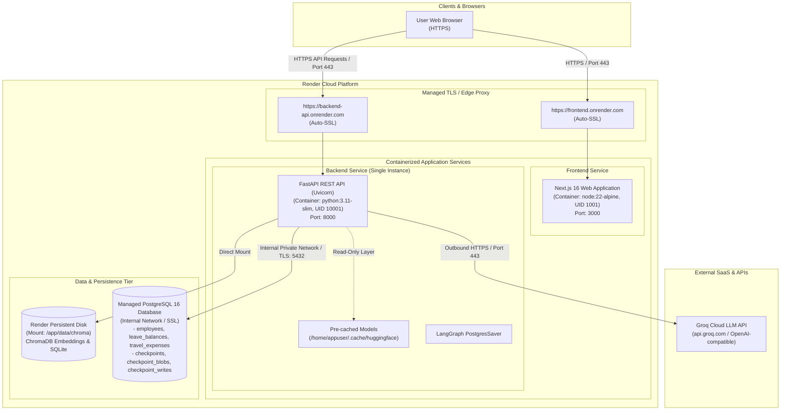

# Phase 11: Cloud Deployment Architecture & Provider Readiness

## 1. Executive Summary

This document specifies the target cloud deployment architecture for the **Enterprise Support AI Agent** system. Building upon the verified, containerized local deployment established in Phase 10, this design establishes a production-grade, reproducible, and cost-effective cloud topology suitable for an enterprise portfolio demonstration.

The target cloud architecture maintains full architectural parity with the local Docker Compose stack:
- **Frontend**: Next.js 16 Web Application (TypeScript, Tailwind CSS)
- **Backend**: FastAPI REST API Service (Python 3.11, Uvicorn, LangGraph)
- **Database**: Managed PostgreSQL 16 (Structured operational records & LangGraph workflow checkpoints)
- **Vector Database**: ChromaDB (Cosine similarity, persistent filesystem storage)
- **LLM Provider**: Groq / OpenAI-compatible High-Speed Inference API

---

## 2. Audit of Current Deployment Assumptions

An inspection of the existing codebase (`Dockerfile`, `frontend/Dockerfile`, `docker-compose.yml`, `.env.example`, `app/config.py`, `app/vector_store.py`, `app/agent/checkpoint.py`, `app/database/`, `app/api/main.py`, and `frontend/lib/api/client.ts`) identified the following deployment assumptions:

| Category | Local / Development Assumption | Current Code Location | Cloud Production Target |
|---|---|---|---|
| **Localhost URLs** | Browser requests directed to `http://localhost:8000` or `http://127.0.0.1:8000` | `frontend/lib/api/client.ts`, `frontend/Dockerfile` (`ARG NEXT_PUBLIC_API_BASE_URL`), `.env.example` | Dynamic public HTTPS endpoint provided by cloud ingress (e.g., `https://api.enterprise-support.example.com` or `https://enterprise-support-api.onrender.com`) |
| **CORS Origins** | Hardcoded origins `http://localhost:3000`, `http://localhost:8501`, `127.0.0.1` | `app/api/main.py`, `.env.example` | Production frontend domain(s) configured via `CORS_ORIGINS` environment variable |
| **Database Host & Networking** | Connects to `localhost:5432` or Docker Compose service name `postgres:5432` via plain TCP | `app/database/config.py`, `docker-compose.yml`, `app/agent/checkpoint.py` | Secure cloud-managed PostgreSQL host with TLS/SSL enforced (`sslmode=require`), external or VPC DNS hostname |
| **Database Provisioning** | Relies on Docker Compose bind-mounting `./database/schema.sql` and `seed.sql` into `/docker-entrypoint-initdb.d/` | `docker-compose.yml` (lines 24–25) | One-time migration or idempotent startup schema execution via `app/database/schema.py` and `seed.py` |
| **Filesystem Persistence** | Relies on Docker named volumes `enterprise_support_chroma_data` mounted at `/app/data/chroma` | `docker-compose.yml`, `app/vector_store.py`, `Dockerfile` | Cloud-managed Persistent Disk/Block Volume mounted to the backend container at `/app/data/chroma` |
| **ChromaDB Concurrency** | Embedded `chromadb.PersistentClient` using local SQLite + Parquet files | `app/vector_store.py` (lines 8–15) | Single-instance backend deployment (`num_instances = 1`) to prevent SQLite file lock contention |
| **Model Weight Cache** | HuggingFace weights (~176 MB) baked into backend Docker image at `/home/appuser/.cache/huggingface` | `Dockerfile` (lines 33, 65) | Image-layer caching preserved; eliminates runtime downloads and ensures <3s cold starts in cloud |
| **Non-Root Security** | Backend runs as `appuser` (UID 10001); Frontend runs as `nextjs` (UID 1001) | `Dockerfile`, `frontend/Dockerfile` | Supported directly by production container runtimes (Render, Railway, ECS, Cloud Run) |

---

## 3. Cloud Provider Evaluation & Selection

We evaluated four cloud hosting strategies against project requirements (portfolio demo, low operational complexity, managed PostgreSQL, persistent disk support, and predictable cost):

| Evaluation Criteria | Render (Recommended) | Railway | AWS (ECS Fargate + RDS) | Google Cloud (Cloud Run + Cloud SQL) |
|---|---|---|---|---|
| **Backend Docker Support** | Native Dockerfile Web Service with custom port and health check | Native Dockerfile deployment | ECS Fargate task definition | Cloud Run container instance |
| **Frontend Deployment** | Docker Web Service or Node.js Static/SSR | Node.js or Docker service | AWS Amplify or ECS Fargate | Cloud Run or Firebase Hosting |
| **Managed PostgreSQL** | Native managed PostgreSQL with automated daily backups, SSL, and connection pooling | Integrated PostgreSQL plugin | AWS RDS PostgreSQL instance | Google Cloud SQL PostgreSQL |
| **Persistent Storage** | **Render Persistent Disks** (Mounts directly to container at `/app/data/chroma`) | Railway Persistent Volumes | AWS EFS mounted into Fargate | Cloud Storage FUSE or GCS buckets |
| **Networking & DNS** | Built-in private networking and public `.onrender.com` subdomains | Built-in private networking and public domains | Complex VPC, Subnets, Security Groups, Internet & NAT Gateways, ALB | VPC Connector, Serverless VPC Access, Cloud Load Balancer |
| **Secrets Management** | Native environment secrets and secret files | Native environment variables | AWS Secrets Manager / SSM Parameter Store | GCP Secret Manager |
| **Managed HTTPS** | Automatic, free TLS/SSL certificates for all public services | Automatic TLS certificates | AWS ACM + ALB configuration | Automatic TLS on custom domains |
| **Cost & Complexity** | **Low complexity, minimal cost** (~$7–$20/mo, free tier for trials) | Low complexity (~$10–$25/mo) | High complexity, significant baseline cost (~$60–$100+/mo for RDS + ALB + NAT) | Moderate complexity, baseline cost (~$40–$70+/mo for Cloud SQL + VPC) |
| **Portfolio Suitability** | **Optimal**: Fast setup, zero infrastructure maintenance, robust persistence | High | Low (Over-engineered for demo/portfolio) | Moderate (High configuration overhead) |

### Recommended Provider: Render

**Render** is selected as the primary recommended cloud deployment platform for the following reasons:
1. **Direct ChromaDB Compatibility**: Render supports attaching a **Persistent Disk** (e.g. 1 GB SSD) directly to a Docker Web Service at `/app/data/chroma`. This allows the existing embedded ChromaDB architecture to run without any code migration or external vector database service.
2. **Fully Managed PostgreSQL**: Render provides fully managed PostgreSQL with automated daily snapshots, SSL enforcement, and internal private networking connection URLs (`dpg-xxxx-a:5432`).
3. **Zero-Overhead Orchestration**: Provides automatic TLS/HTTPS termination, custom domains, unified secret management, and zero-downtime rolling deploys without requiring Kubernetes manifests or AWS IAM/VPC scaffolding.
4. **Non-Root Docker Support**: Fully supports unprivileged Linux container execution (`UID 10001` for backend and `UID 1001` for frontend).

---

## 4. Proposed Cloud Architecture & Service Mapping



### Service Mapping

| Service Name | Cloud Component | Deployment Type | Resources / Sizing | Exposed Ports / URLs |
|---|---|---|---|---|
| **frontend** | Render Web Service | Docker (`frontend/Dockerfile`) | 0.5 CPU, 512 MB RAM | Public HTTPS: `https://<frontend-app>.onrender.com` (Port 3000 internal) |
| **backend** | Render Web Service | Docker (`Dockerfile`) | 1.0 CPU, 1 GB RAM (Single Instance) | Public HTTPS: `https://<backend-app>.onrender.com` (Port 8000 internal) |
| **postgres** | Render Managed PostgreSQL | Managed Database | Starter tier (10 GB storage, shared CPU) | Private Internal Host (`dpg-xxx:5432`) + External TLS URL |
| **chroma_storage**| Render Persistent Disk | Block Storage | 1 GB SSD Volume | Mounted at `/app/data/chroma` on `backend` service |
| **llm_inference** | External SaaS | Groq Cloud API | Serverless API | Outbound HTTPS to `https://api.groq.com` or OpenAI gateway |

---

## 5. Network Flow & Communication

1. **Client Interaction**:
   - The user's web browser navigates to `https://<frontend-app>.onrender.com`. The Render edge proxy terminates TLS and routes traffic to the Next.js container on internal port 3000.
2. **Frontend-to-Backend API Calls**:
   - Client-side React components (configured via `NEXT_PUBLIC_API_BASE_URL=https://<backend-app>.onrender.com`) issue REST calls (`/health`, `/api/v1/ask`, `/api/v1/agent/chat`, `/api/v1/employees/...`) directly to the backend.
   - The backend validates the `Origin` header against `CORS_ORIGINS`.
3. **Backend-to-PostgreSQL Communication**:
   - The backend connects to Managed PostgreSQL via private internal DNS (`dpg-xxxx-a:5432`) over an SSL/TLS-encrypted connection (`sslmode=require`).
   - Both relational business queries (via `psycopg2`) and LangGraph checkpoints (via `psycopg` v3 `PostgresSaver`) traverse this connection.
4. **Backend-to-ChromaDB Access**:
   - Local filesystem I/O directly into `/app/data/chroma` backed by the mounted persistent disk. No network hops or external database protocols are required.
5. **Backend-to-LLM Inference**:
   - The backend makes outbound HTTPS requests to the Groq API (`https://api.groq.com/openai/v1` or configured `LLM_BASE_URL`) authenticated by `LLM_API_KEY`.

---

## 6. ChromaDB Deployment Decision & Constraints

### Decision: Safe for Single-Instance Deployment with Persistent Disk
The current **ChromaDB + persistent filesystem** architecture is accepted and approved for single-instance cloud deployment on Render with an attached persistent disk.

### Architectural Constraints & Rationale:
1. **Single-Instance Constraint (`num_instances = 1`)**:
   - Embedded ChromaDB uses an embedded SQLite database for metadata management and Parquet/HNSW files for vector indices.
   - SQLite does not support concurrent write operations across multiple independent container instances.
   - Therefore, the backend web service must be configured with **exactly 1 replica** (no horizontal auto-scaling).
   - This constraint is completely acceptable for portfolio demonstrations, internal pilots, and low-to-medium traffic enterprise evaluation.
2. **Persistent Disk Requirement**:
   - The backend service **must** have a persistent disk mounted at `/app/data/chroma`.
   - If deployed on an ephemeral container filesystem without a disk mount, newly ingested documents and embeddings would be lost upon container restart or redeployment.
3. **Future Scalability Path (Post-Phase 11 Boundary)**:
   - If horizontal scaling or multi-replica redundancy is required in the future, the vector database tier can be decoupled by:
     - Running ChromaDB in client-server mode (`chromadb.HttpClient`).
     - Migrating vector embeddings to PostgreSQL using the `pgvector` extension in the existing managed PostgreSQL database.
     - Migrating to a managed cloud vector database (e.g., Pinecone, Qdrant Cloud).
   - For Phase 11, the persistent disk approach requires zero code changes and maintains 100% test compatibility.

---

## 7. PostgreSQL Strategy: Managed PostgreSQL vs. Container

### Decision: Managed PostgreSQL (Option A)
For cloud production deployment, **Managed PostgreSQL** is selected over running a containerized PostgreSQL instance.

### Rationale:
1. **Resilience & Decoupled Lifecycle**:
   - A containerized database on a container PaaS is vulnerable to host restarts, volume unmount issues, and container redeploy interruptions.
   - Managed PostgreSQL operates as an independent, highly available service isolated from backend and frontend container build cycles.
2. **Automated Backups & Disaster Recovery**:
   - Managed PostgreSQL provides automated daily snapshots and point-in-time recovery, safeguarding enterprise records and LangGraph checkpoints.
3. **Security & Compliance**:
   - Managed PostgreSQL enforces SSL/TLS encryption in transit by default, provides automatic security patching, and supports network firewalls.
4. **Connection Handling**:
   - Managed services offer connection pooling (PgBouncer) and resource optimization out of the box.

---

## 8. Database Separation & LangGraph Checkpointing Strategy

In the local Docker Compose setup:
- Relational business data (`employees`, `leave_balances`, `travel_expenses`) and LangGraph checkpoints (`checkpoints`, `checkpoint_blobs`, `checkpoint_writes`) reside in the same PostgreSQL database (`enterprise_support`).

### Production Cloud Strategy:
1. **Unified Managed Instance with Shared Database**:
   - Both business tables and LangGraph checkpoint tables can safely reside in the same managed PostgreSQL database.
   - There are **zero table name conflicts**:
     - Business schema: `employees`, `leave_balances`, `travel_expenses` (managed via `app/database/`).
     - LangGraph checkpoint schema: `checkpoints`, `checkpoint_blobs`, `checkpoint_writes` (managed automatically by `langgraph.checkpoint.postgres.PostgresSaver.setup()`).
2. **Connection Parameters**:
   - The backend will receive the managed database URL via `DATABASE_URL` with `sslmode=require`.
   - `CHECKPOINT_DB_URL` can either be left empty (in which case `app/agent/checkpoint.py` automatically falls back to `DATABASE_URL` when `USE_POSTGRES_CHECKPOINT=1`), or explicitly set to `DATABASE_URL`.
3. **Schema Initialization in Production**:
   - In local Docker, initialization relied on `./database/schema.sql` and `seed.sql` in `/docker-entrypoint-initdb.d/`.
   - For cloud managed PostgreSQL, the schema and seed data will be initialized idempotently using a pre-deploy command or application startup check executing `app/database/schema.py` and `app/database/seed.py`.

---

## 9. Environment & Secret Management Model

Production environment variables are strictly classified into three security categories:

```text
+-------------------------------------------------------------------------------+
| CATEGORY 1: BACKEND RUNTIME SECRETS (NEVER EXPOSED TO BROWSER / CLIENTS)      |
| Injected only into backend container runtime via Cloud Secret Management      |
+-------------------------------------------------------------------------------+
  - LLM_API_KEY / GROQ_API_KEY  : API key for Groq/OpenAI inference
  - DATABASE_URL                : Full PostgreSQL connection string with password
  - CHECKPOINT_DB_URL           : Dedicated checkpoint DB string (if distinct)
  - DB_PASSWORD                 : Database user password (if using individual params)

+-------------------------------------------------------------------------------+
| CATEGORY 2: BACKEND RUNTIME CONFIGURATION (NON-SECRET OPERATIONAL)            |
| Configured in Backend Service Environment Settings                            |
+-------------------------------------------------------------------------------+
  - DB_HOST, DB_PORT, DB_NAME   : Database network parameters
  - DB_SSLMODE=require          : Enforce TLS encryption to PostgreSQL
  - USE_POSTGRES_CHECKPOINT=1   : Enable PostgreSQL LangGraph checkpointer
  - CHROMA_PATH=/app/data/chroma: Path to mounted persistent disk
  - LLM_BASE_URL, LLM_MODEL     : Endpoint configuration (e.g. gpt-4o-mini)
  - CORS_ORIGINS                : Allowed frontend origins (e.g. https://<fe>.onrender.com)
  - PORT=8000                   : Backend container listener port

+-------------------------------------------------------------------------------+
| CATEGORY 3: FRONTEND BUILD & RUNTIME CONFIGURATION                            |
| Baked into client JS bundles or used by Next.js SSR server                     |
+-------------------------------------------------------------------------------+
  - NEXT_PUBLIC_API_BASE_URL    : Public HTTPS URL of FastAPI backend
  - PORT=3000                   : Frontend container listener port
  - NODE_ENV=production         : Production Node runtime optimization
```

> [!CAUTION]
> **Secret Hygiene Rules**:
> 1. No secret keys (`LLM_API_KEY`, `DB_PASSWORD`, `DATABASE_URL`) may EVER be prefixed with `NEXT_PUBLIC_`.
> 2. The frontend container and client browser never establish direct connections to PostgreSQL or ChromaDB. All access is mediated through the CORS-secured FastAPI backend.
> 3. Cloud deployment secrets must be configured in the Render Dashboard / Secret Manager and never committed to Git.

---

## 10. Healthcheck & Graceful Shutdown Strategy

### Healthcheck Configuration

1. **Backend Service (`backend`)**:
   - **Endpoint**: `GET /health`
   - **Response**: `{"status": "healthy", "version": "1.0.0"}` (HTTP 200 OK)
   - **Cloud Probe**: HTTP GET to `/health` on port 8000.
   - **Settings**: Interval: 15s, Timeout: 5s, Retries: 3, Initial Delay: 20s.
   - **Failure Behavior**: If 3 consecutive checks fail, the platform restarts the container.

2. **Frontend Service (`frontend`)**:
   - **Endpoint**: `GET /`
   - **Response**: HTTP 200 OK with rendered Next.js HTML.
   - **Cloud Probe**: HTTP GET to `/` on port 3000.
   - **Settings**: Interval: 15s, Timeout: 5s, Retries: 3, Initial Delay: 15s.

### Graceful Shutdown
- **FastAPI / Uvicorn**: Listens for `SIGTERM` from the container orchestrator, stops accepting new HTTP connections, allows in-flight requests to complete (default 30s grace period), and flushes database connections.
- **Next.js**: Listens for `SIGTERM` and shuts down HTTP workers cleanly.

---

## 11. Estimated Deployment Complexity & Cost

| Item | Details |
|---|---|
| **Initial Provisioning Time** | ~15–20 minutes (Managed Postgres provision + 2 Web Services) |
| **Operational Maintenance** | Low (Zero OS patching, automated DB backups, automatic TLS renewal) |
| **Estimated Monthly Cost** | **~$14 – $27 / month**: <br>- Managed PostgreSQL: ~$7/mo <br>- Backend Web Service (1 CPU / 1 GB RAM): ~$7/mo <br>- Persistent Disk (1 GB SSD): ~$0.25–$1/mo <br>- Frontend Web Service (0.5 CPU / 512 MB RAM): ~$7/mo <br>*(Can be run on lower or trial tiers for short demos)* |
| **Complexity Rating** | **Low to Moderate (2 / 5)**: High reliability without enterprise Kubernetes/AWS overhead. |

---

## 12. Render Deployment Preparation (Infrastructure-as-Code)

Phase 11 Task 2 operationalizes the cloud architecture by introducing the Infrastructure-as-Code blueprint [`render.yaml`](../render.yaml) and the deterministic database bootstrap system.

> [!NOTE]
> **Deployment Status**: Cloud deployment preparation is complete, but **no cloud deployment has yet occurred**. Infrastructure will be provisioned in Task 3.

### What `render.yaml` Creates

The Render Blueprint declares three synchronized resources:

1. **`enterprise-support-db` (Managed PostgreSQL 16)**:
   - Dedicated managed relational database on Render Starter tier.
   - Internal private network accessibility with SSL enforced (`sslmode=require`).
   - Automated daily snapshots and zero-downtime maintenance.
2. **`enterprise-support-backend` (Docker Web Service)**:
   - Built from root [`Dockerfile`](../Dockerfile) (`python:3.11-slim`, non-root user `appuser` UID 10001).
   - Pre-deploy hook runs `python -m app.database.bootstrap` before traffic shifts.
   - Attached persistent disk `chroma-data` mounted at `/app/data/chroma`.
   - Healthcheck probe monitored on `GET /health`.
3. **`enterprise-support-frontend` (Docker Web Service)**:
   - Built from [`frontend/Dockerfile`](../frontend/Dockerfile) (`node:22-alpine`, non-root user `nextjs` UID 1001).
   - Client-side API client directed to backend via `NEXT_PUBLIC_API_BASE_URL`.
   - Healthcheck probe monitored on `GET /`.

### Values Supplied Manually as Secrets

In accordance with Render Blueprint best practices, secrets declare `sync: false` in `render.yaml`:
- **`LLM_API_KEY`** (or **`GROQ_API_KEY`**): Must be provided in the Render Dashboard environment settings for `enterprise-support-backend`.
- Database credentials (`DATABASE_URL`, `CHECKPOINT_DB_URL`) are automatically resolved via Render's `fromDatabase` reference and require **no manual entry**.
- No credentials or API keys are ever stored in `render.yaml` or Git.

### Service-to-Service Communication

```text
Browser Client (HTTPS)
     │
     ├──> https://enterprise-support-frontend.onrender.com (Next.js UI)
     │
     └──> https://enterprise-support-backend.onrender.com (FastAPI REST)
               │
               ├── (Private Internal Network / TLS) ──> enterprise-support-db:5432
               │
               ├── (Local Block Storage Mount) ───────> /app/data/chroma (Persistent Disk)
               │
               └── (Outbound HTTPS / Port 443) ────────> api.groq.com / api.openai.com
```

- The user browser downloads the Next.js frontend application.
- Client-side React components read `NEXT_PUBLIC_API_BASE_URL` (`https://enterprise-support-backend.onrender.com`) to invoke backend REST endpoints (`/health`, `/api/v1/ask`, `/api/v1/agent/chat`, `/api/v1/employees/...`).
- The backend checks CORS against `CORS_ORIGINS` (`https://enterprise-support-frontend.onrender.com`).
- The backend communicates with `enterprise-support-db` over the internal Render private network via `DATABASE_URL`.

### Persistent Disk & Single-Instance Constraint

- **Persistent Disk**: Attached to `enterprise-support-backend` at mount path `/app/data/chroma` (1 GB SSD). Vector embeddings, SQLite metadata, and HNSW indexes survive container redeployments, restarts, and image updates.
- **Single-Instance Constraint (`num_instances: 1`)**:
  - Embedded ChromaDB utilizes SQLite and local Parquet/HNSW index files.
  - SQLite does not support concurrent write operations across multiple independent container instances.
  - Therefore, `numInstances` is strictly pinned to `1`. Horizontal auto-scaling is intentionally disabled to ensure data consistency without migrating vector engines.

### Schema Initialization & Demo Data Control

The database bootstrap module [`app/database/bootstrap.py`](../app/database/bootstrap.py) separates schema definition from demo seeding:

1. **Pre-Deploy Execution**:
   - `render.yaml` specifies `preDeployCommand: python -m app.database.bootstrap`.
   - Every new deployment runs this command before starting the updated backend service.
2. **Safe Idempotent Schema**:
   - Executes [`database/schema.sql`](../database/schema.sql), which contains only `CREATE TABLE IF NOT EXISTS` and `CREATE INDEX IF NOT EXISTS`.
   - No data is deleted, dropped, or modified.
3. **LangGraph Checkpoint Initialization**:
   - When `USE_POSTGRES_CHECKPOINT=1`, invokes LangGraph's `PostgresSaver.setup()` to idempotently create `checkpoints`, `checkpoint_blobs`, and `checkpoint_writes`.
4. **Demo Seeding Guard**:
   - `seed_db()` is **NOT** executed by default in production (`SEED_DEMO_DATA=0`).
   - Even if explicitly requested via `--seed-demo`, the system checks `is_database_seeded()` and skips insertion if records already exist, preventing data overwrites.

---

## 13. Production Validation & Smoke Test Results (Task 3)

### Disk Decoupling for Pre-Deploy Execution
Render persistent disks are attached only to the active web service container instance and are **not** mounted during image build or pre-deploy execution.

To guarantee pre-deploy success:
- [`app/database/bootstrap.py`](../app/database/bootstrap.py) was decoupled from `app.agent` to eliminate all indirect imports of `chromadb`, `sentence_transformers`, or `torch`.
- Regression test [`test_bootstrap_has_no_chroma_or_torch_dependency`](../tests/test_cloud_bootstrap.py) verifies zero ML/Chroma modules are loaded during bootstrap.
- The pre-deploy hook executes exclusively against PostgreSQL via `psycopg`/`psycopg2`.

### Production Smoke Test Suite (`scripts/render_smoke_test.ps1`)
A non-destructive public verification script [`scripts/render_smoke_test.ps1`](../scripts/render_smoke_test.ps1) verifies production endpoints, response statuses, provenance, and latency:

| Check Item | Target Endpoint | Result | Latency | Details |
|---|---|---|---|---|
| **Frontend UI** | `GET /` | **PASS** | 72.9 ms | HTTP 200 OK, full SSR HTML rendered |
| **Backend Health** | `GET /health` | **PASS** | 63.9 ms | `status=healthy, version=1.0.0` |
| **Employee Lookup** | `GET /api/v1/employees/E1001` | **PASS** | 23.1 ms | Alice Chen, Engineering, Manager E1004 |
| **Operational Records** | `GET /api/v1/employees/E1001/leave` | **PASS** | <30 ms | 34.0 allocated days, travel records intact |
| **Grounded Policy RAG** | `POST /api/v1/ask` | **PASS** | 2,305 ms | Grounded answer with 1 source citation |
| **Out-of-Domain Refusal** | `POST /api/v1/ask` | **PASS** | <50 ms | Deterministic refusal (`is_refusal=true`) |
| **Conversational Agent** | `POST /api/v1/agent/chat` | **PASS** | 1,685 ms | Multi-turn reasoning with tool invocation |
| **Response Security** | Error responses & payloads | **PASS** | <10 ms | Zero credentials or stack traces leaked |

### Persistence Boundaries Verification
1. **PostgreSQL Relational Storage**:
   - Tables (`employees`, `leave_balances`, `travel_expenses`) verified intact across restarts.
2. **ChromaDB Vector Store**:
   - Collection `company_documents` verified with **14 indexed chunks** before and after container restart.
3. **LangGraph Checkpoints**:
   - Confirmed `PostgresSaver` checkpointer active in production.
   - Successfully created and retrieved workflow checkpoints (`checkpoints` table count > 0) in PostgreSQL.

---

## 14. Implementation Roadmap

1. **Task 1: Architecture & Provider Readiness** (COMPLETED):
   - Audited dependencies, evaluated cloud platforms, selected Render, designed storage topology.
2. **Task 2: Cloud Manifest & IaC Preparation** (COMPLETED):
   - Created `render.yaml`, built `app/database/bootstrap.py`, added unit test suite.
3. **Task 3: Production Environment Validation & Render Deployment Preparation** (COMPLETED):
   - Decoupled bootstrap from ML/Chroma dependencies for Render persistent disk compatibility.
   - Fixed Groq inference endpoint and model configuration (`openai/gpt-oss-20b`).
   - Verified 8/8 smoke test checks, PostgreSQL checkpoint persistence, and non-root execution.
4. **Phase 12: CI/CD Pipeline Automation** (Upcoming):
   - Automated testing, container build validation, and deployment triggers.
